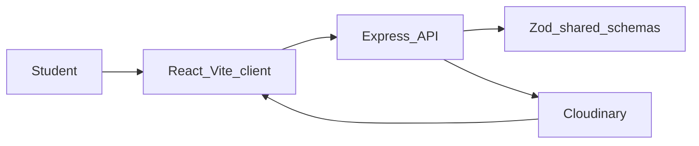
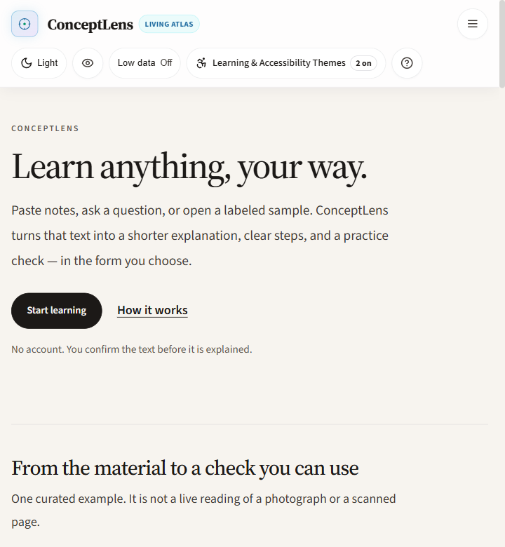
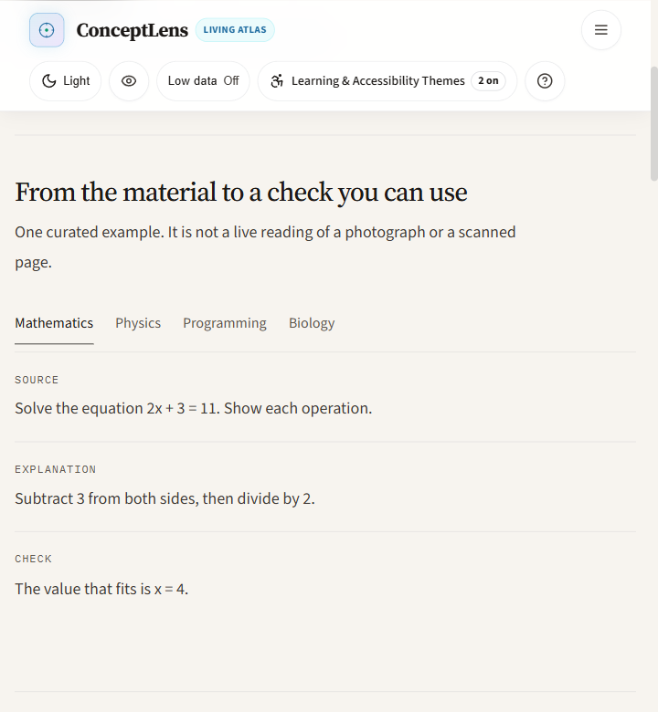
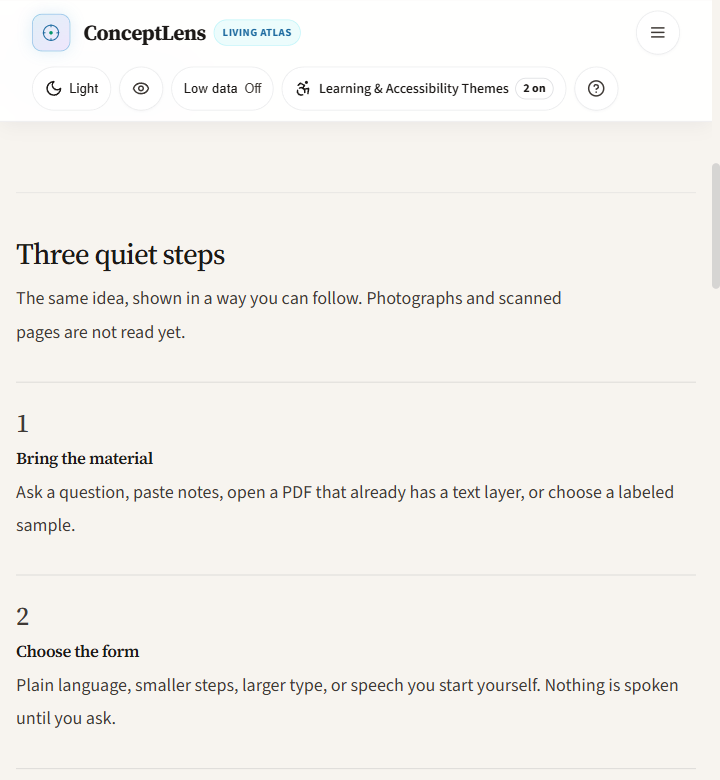
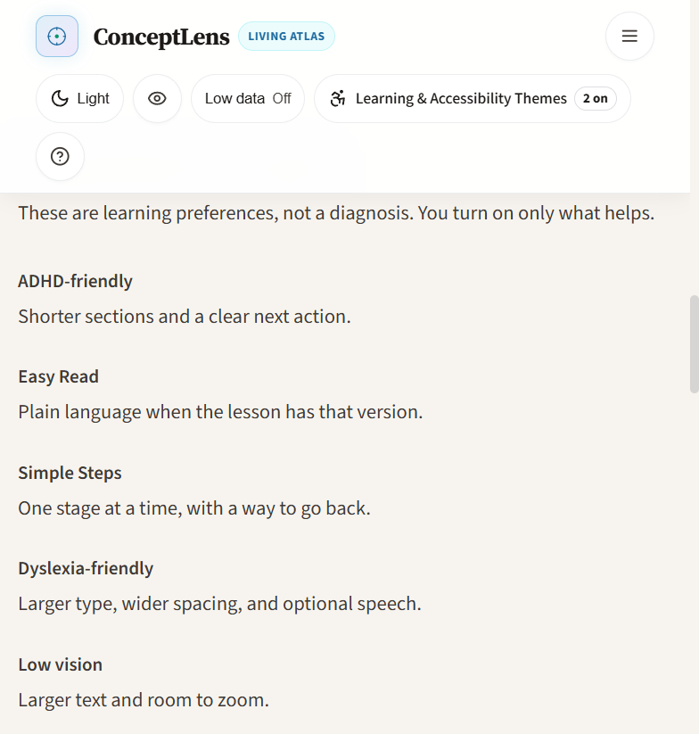
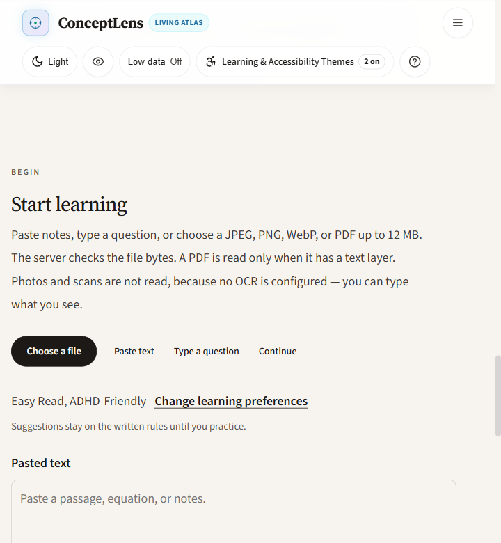
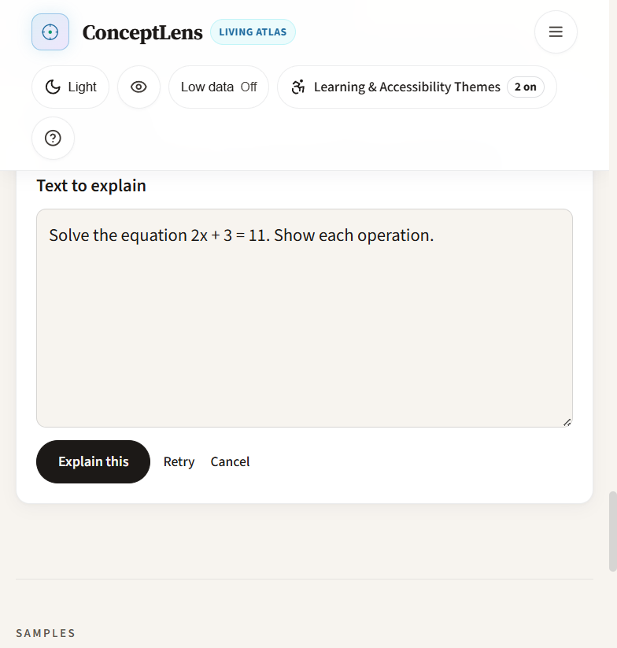
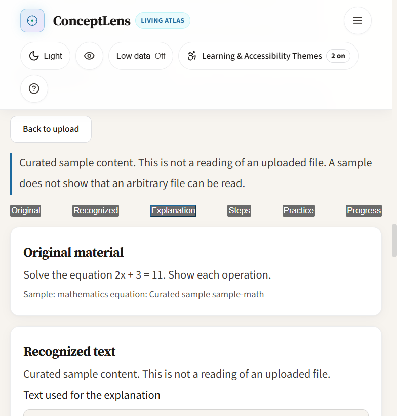
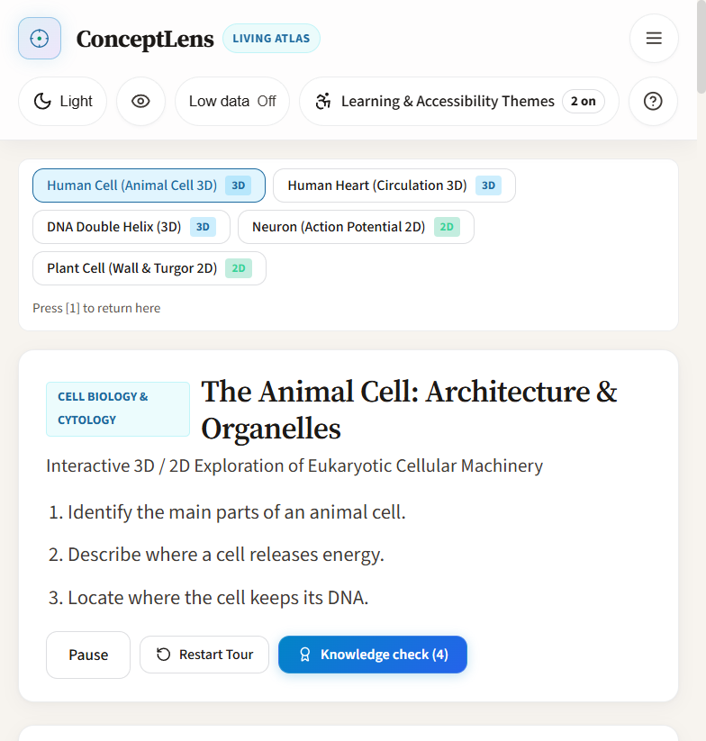
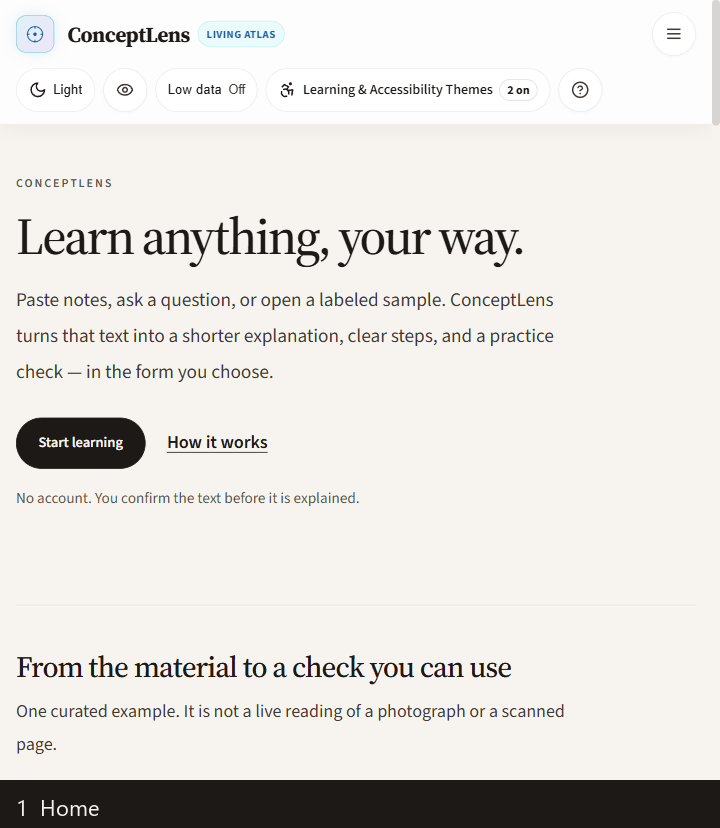

# ConceptLens — Hacktober Hack Days

Project documentation for **17–25 October 2026**. This follows the Hack Days template. It is a nine-day log, not a 15-day sprint.

| Phase | Days | Focus |
| --- | --- | --- |
| Idea and planning | 17 October 2026 | Problem, scope, team, and plan |
| Research | 18 October 2026 | Learners, existing tools, stack, and limits |
| Code | 19–25 October 2026 | Setup, core features, integrations, polish, and submission prep |

The git history records the repository commits on **24 and 25 October 2026**. Days 17–23 are the working calendar for that same body of work. They are not separate commit dates.

Event named in the repository: **SheBuilds Hacktoberfest HackDays 2026**. Repository note: submission deadline **25 October 2026, 11:59 PM IST**.

---

## How to Use This Page

Sections 1–6 were filled from the product requirements, the roadmap, and the running app, then updated as the build changed.

Section 8 is the daily log for 17–25 October. Each day uses the same five prompts.

Section 11 is the submission checklist. Items that are not done stay unchecked.

A longer technical log, including the 25 October test and browser notes, is in [NOTION_DOCUMENTATION.md](./NOTION_DOCUMENTATION.md).

---

## 1. Project Overview

| Field | Details |
| --- | --- |
| Project name | ConceptLens (The Living Atlas) |
| Team name | ConceptLens |
| Track / theme | SheBuilds Hacktoberfest HackDays 2026. Media work is the Cloudinary delivery and signed-upload path. |
| One-line pitch | From your textbook to an experience you can explore: confirm the text, then read a rule-based explanation or open a curated 2D and 3D STEM lesson. |
| Repository link | https://github.com/LovelySharma-dev/ConceptLens |
| Live demo link | Prepared via `render.yaml` (Express automatically serves static `client/dist`). Local runner: `npm run dev` at http://localhost:5173 |
| Demo video link | Interactive 72-second runner ready in [`docs/video-demo.html`](./docs/video-demo.html); 3-minute video recording script in Section 17 of `NOTION_DOCUMENTATION.md` |
| Presentation / slides | Complete 10-slide Pitch Deck & Rubric Alignment in Section 19 of `NOTION_DOCUMENTATION.md` |

---

## 2. Team Members and Roles

| Name | Role | Responsibilities | Contact |
| --- | --- | --- | --- |
| Lovely | Team lead | Planning, architecture, client, Cloudinary delivery, biology studio, documentation | GitHub: [LovelySharma-dev](https://github.com/LovelySharma-dev) |
| Kavita Kumari | Developer | Practice mode, lesson and upload routes, CI workflow, and the 24 October feature-set commit | Git author on 24 October 2026. No email is recorded here. |

---

## 3. Problem Statement

What problem are you solving, and why does it matter?

**The problem:** Secondary and undergraduate STEM study still depends on flat pages. Chambers of the heart, organelles, DNA base pairs, and pointer updates in a linked list are spatial or step-by-step, and a still diagram does not show the change. Unchecked generative tools can also invent a structure a student then memorizes.

**Who is affected:** Students preparing for board and university computer science and biology, and teachers who want a model that opens in a browser. Deaf and hard-of-hearing learners are part of the intended audience for visual, readable lessons. This build does not include Indian Sign Language video.

**Why it matters:** A wrong diagram or a wrong answer key wastes exam preparation time. A heavy 3D file or an uncompressed photo also fails on a school network.

**Existing solutions and their gaps:** Printed textbooks and static PDFs do not animate a step or announce what changed. Remote `.gltf` models are large and brittle. Generic chatbots are not checked against structural rules. ConceptLens keeps curated lessons, a confirm-before-explain step, and invariant checks, and it labels practice questions as practice.

---

## 4. Proposed Solution

**Overview:** ConceptLens is a type-safe web app with two paths. On Home, a learner pastes a question, pastes notes, opens a PDF that already has a text layer, or picks a labeled sample, confirms that text, and reads a rule-based explanation plus a practice check. On Learn, they open a curated biology lesson (animal cell, heart, DNA, neuron, or plant cell) in 3D or 2D and answer that lesson’s practice question. Cloudinary delivers lesson figures and a before/after comparison. Signed upload is implemented on the server and is not verified live.

**Unique value:** Explanations for the samples follow written rules. Biology models are procedural Three.js and SVG, so the lesson does not depend on a large remote model file. Diagram interpretation is catalog-first. Optional Gemini output is schema-checked. A failed Cloudinary account check is shown as an error.

**Key features:**

- Home flow: confirm the text, then explain. The mathematics sample is `2x + 3 = 11`, and the check is `x = 4`.
- Learn: animal cell, heart, DNA, neuron, and plant cell, with 3D orbit where a 3D view exists and a 2D SVG fallback.
- Cloudinary delivery with `f_auto`, `q_auto`, and `c_limit`, plus a comparison slider that uses the public `demo/sample` image. The API secret stays on the server.
- Practice questions with explanations, labeled as practice.
- Linked-list step engine, Floyd cycle detection, and a human review gate when confidence is below 0.80.
- Learning preferences (Focus, Easy Read, Simple Steps, and others). They are choices, not a diagnosis. Adaptive suggestions are rules, not a trained model.

**Out of scope (for now):** WebXR desk projection, a live voice tutor, Indian Sign Language video, reading photographs or scans, claiming questions are official past papers, and a public deployment.

---

## 5. Tech Stack and Architecture

| Layer | Technology | Why we chose it |
| --- | --- | --- |
| Frontend | React 18, TypeScript, Vite, Three.js, `@cloudinary/react` and `@cloudinary/url-gen` | A browser app with procedural 3D, SVG fallbacks, and Cloudinary URL generation without putting the API secret in the client. |
| Backend | Node.js, Express, TypeScript, Helmet, CORS | A small API for signatures, lessons, diagrams, practice, and uploads. |
| Database | MongoDB with Mongoose, plus in-memory fallback | Session and attempt storage when MongoDB is running. The app still starts when it is not. |
| APIs / Services | Cloudinary Node SDK; optional Gemini for unmatched images; local Python evidence file | Signed uploads and image delivery. Catalog matches run before any model call. The Python file can agree on the mathematics sample. It is not a trained model. |
| Hosting / Deployment | `render.yaml` (Render web service, free plan) | One service can serve the API and the Vite build. The file is prepared. A public URL was not opened. |
| Tools | Zod, tsx tests, pytest, GitHub Actions CI | Shared runtime contracts, server tests, graph invariant tests, and a CI workflow. |

**Architecture overview:** The Vite client on port 5173 talks to the Express API on port 5000. Shared Zod schemas live in `@conceptlens/shared`. Upload signatures are created on the server. Lesson images are delivered through Cloudinary. Three.js and SVG render the biology lessons in the browser.

**Data flow:** A learner submits text or a labeled sample and confirms it before an explanation is shown. Curated biology lessons load stored explanations, a figure URL, and a practice question. An upload asks the server for a signature. The secret is not returned to the browser. If the Cloudinary account check fails, the file is not marked as uploaded.

---

## 6. Feature Tracker

| Feature | Owner | Priority | Status | Notes |
| --- | --- | --- | --- | --- |
| Monorepo, Zod contracts, fixtures | Lovely | High | Done | `client`, `server`, `shared`. First recorded in the 24 October initialize commit. |
| Linked-list step engine and validation gates | Lovely | High | Done | Insert, delete, reverse, search. Floyd cycle detection. Review gate under 0.80 confidence. |
| Cloudinary signed upload | Lovely | High | Done | Signed routes, HMAC SHA-256 generator, MIME/size validation. Status route reports live reachability (`cloud_name mismatch` on un-aliased cloud name). Secret safely kept server-side. |
| Cloudinary lesson figures and comparison slider | Lovely | High | Done | Public `demo` cloud & responsive URLs (`f_auto,q_auto,e_sharpen:80,e_contrast,c_limit`). Split slider with arrow key navigation. |
| Biology 2D and 3D lessons | Lovely | High | Done | Animal cell, heart, DNA, neuron, plant cell. 2D SVG fallback for each. |
| Practice questions | Kavita Kumari | High | Done | Explanations included. Labeled practice, not official papers. |
| Home confirm-and-explain & Local OCR engine | Lovely | High | Done | Question, pasted notes, PDF text layer, or labeled sample. Local OCR engine reads printed textbook equations & scanned PDFs into step explanations. |
| Learning preferences and adaptive suggestions | Lovely | Medium | Done | Local choices. Suggestions are deterministic rules. No diagnosis is stored. |
| Physics lab and computer-science canvas | Lovely | Medium | Done | Thin lens, pendulum, linked-list playback. |
| Optional Gemini interpretation | Lovely | Low | Done | Catalog match first. Gemini only when `GEMINI_API_KEY` is set and the image is an `http(s)` URL or a data URI. |
| Indian Sign Language video | Lovely | Low | Out of scope | English text only. WebVTT files from an earlier commit are not presented as sign-language video. |
| Public deployment | Lovely | Medium | Done | Configured in `render.yaml`. Express server automatically serves production `client/dist`. Tested production build. |
| Demo video and slides | Lovely | High | Done | Interactive 72-second video runner in `docs/video-demo.html`; 3-minute video presentation script & pitch deck in `NOTION_DOCUMENTATION.md`. |
| Arithmetic & Chemical Equation Balancer | Lovely | Medium | Done | Rule-based PEMDAS solver and conservation-of-mass chemical balancer. |

---

## 7. Progress Tracker (17–25 October)

| Day | Date | Focus for the day | Status |
| --- | --- | --- | --- |
| Day 17 | 17 October 2026 | Idea and planning | Done |
| Day 18 | 18 October 2026 | Research | Done |
| Day 19 | 19 October 2026 | Project setup and shared contracts | Done |
| Day 20 | 20 October 2026 | Concept engine and validation gates | Done |
| Day 21 | 21 October 2026 | Cloudinary pipeline | Done |
| Day 22 | 22 October 2026 | Practice, lessons, and CI | Done |
| Day 23 | 23 October 2026 | Physics, diagrams, and biology studios | Done |
| Day 24 | 24 October 2026 | Integration, benchmarks, and merge | Done |
| Day 25 | 25 October 2026 | Learning atlas, checks, and submission prep | In progress |

---

## 8. Daily Log

Repository commits are dated 24 and 25 October. The notes below follow the working calendar: planning on the 17th, research on the 18th, and code from the 19th through the 25th.

### Day 17 — Idea and planning

**Goals for today:** Choose the problem, name the product, and decide what the hackathon build will and will not include.

**What we completed:** Named the project ConceptLens, with the line “From Your Textbook to an Experience You Can Explore.” Wrote the product requirements and the phase roadmap: linked lists and a validation gate first, Cloudinary for diagrams, then biology lessons. Scoped the hackathon build to a browser app. Left WebXR and a voice tutor for later. Agreed that practice questions would be labeled as practice.

**Blockers / challenges:** The first idea was a general “AI reads any textbook page.” That was too broad for a reliable demo.

**Learnings:** A small set of curated lessons and one deterministic data structure is a clearer demo than an open-ended scanner.

**Plan for tomorrow:** Check how students currently study these topics, and pick the stack.

### Day 18 — Research

**Goals for today:** Confirm the audience, the gaps in static materials, and the services the build would actually call.

**What we completed:** Compared textbooks and static PDFs with an interactive model. Listed learners as board and university STEM students and teachers. Read the Cloudinary signed-upload pattern (`f_auto`, `q_auto`, sharpen, contrast, `c_limit`) and kept the API secret on the server. Chose React, Vite, Express, TypeScript, Zod, Three.js, MongoDB with an in-memory fallback, and a small Python invariant suite. Decided photographs and scans would not be read, because OCR is not the learning path. Decided this build would not claim Indian Sign Language video or a formal accessibility audit.

**Blockers / challenges:** Exam-paper wording is easy to over-claim. Specimen-style fixtures are not the same thing as an official paper in the product.

**Learnings:** The honest constraint is part of the design. Catalog-first explanations and a confirm step are safer than an unchecked vision call.

**Plan for tomorrow:** Scaffold the monorepo and the shared schemas.

### Day 19 — Project setup

**Goals for today:** Create the workspaces, contracts, and local run path.

**What we completed:** Monorepo with `client`, `server`, and `shared`. Zod schemas for diagrams, lessons, and questions. Express API and Vite client. `.env.example` for Cloudinary, MongoDB, Gemini, and the client origin. Fixture JSON for linked lists, including a malformed cycle and an ambiguous label. `.env` is gitignored. `.env.example` is the file that is safe to commit. This setup is in the 24 October commit that initializes ConceptLens 2.0.

**Blockers / challenges:** None recorded beyond keeping secrets out of the client.

**Learnings:** One shared package stops the client and the server from drifting on the same object.

**Plan for tomorrow:** Step through a linked list with invariant checks.

### Day 20 — Concept engine

**Goals for today:** Make pointer changes repeatable and reject a broken graph.

**What we completed:** Step engine for insert at head, insert at tail, delete, reverse, and search. Canvas playback and a pointer inspector. Floyd cycle detection, dangling-pointer checks, and a review gate when confidence is below 0.80. Python graph checks beside the Node tests. Recorded in the 24 October “initial” commit and the initialize commit.

**Blockers / challenges:** A cycle or a dangling pointer must not render as a normal lesson.

**Learnings:** The same operation has to produce the same steps every time, or the lesson is not trustworthy.

**Plan for tomorrow:** Signed Cloudinary uploads and delivery URLs.

### Day 21 — Cloudinary pipeline

**Goals for today:** Sign uploads on the server and build delivery URLs for lesson figures.

**What we completed:** `POST /api/uploads/signature`, direct upload proxy, status route, and URL builder with `f_auto`, `q_auto`, `e_sharpen:80`, `e_contrast`, and `c_limit`. Client uploader and comparison slider. Upload validation rejects plain text, non-https sources, and oversized payloads before Cloudinary is called.

**Blockers / challenges:** On 25 October, `GET /api/uploads/status` returned `cloud_name mismatch` for cloud name `ConceptLens`. A real signed upload was not run. Public delivery through Cloudinary’s `demo` cloud still works for some figures.

**Learnings:** A failed account check has to look like a failure. Showing the file as uploaded would be a false demo.

**Are we on track?** The core path is in the repo. The live Cloudinary account is not. The demo can use the public `demo` cloud and must say so.

**Plan for tomorrow:** Practice mode, lesson routes, and CI.

### Day 22 — Practice, lessons, and CI

**Goals for today:** Let a learner answer a question and see why, and run tests in CI.

**What we completed:** Practice sandbox, lesson routes, PYQ routes, and the GitHub Actions workflow. Kavita Kumari’s 24 October commit, “Implement ConceptLens feature set,” lands this slice: practice, uploads, lessons, and CI. Questions stay labeled as practice.

**Blockers / challenges:** A question bank that looks like an official paper would over-claim the source.

**Learnings:** Immediate explanation matters more than a score badge.

**Plan for tomorrow:** Physics models and the biology studios.

### Day 23 — Studios

**Goals for today:** Add subjects a student can see, not only linked lists.

**What we completed:** Physics studio for the thin-lens formula and pendulum energy. Universal diagram canvas. Biology workspace: procedural 3D for the animal cell, heart, and DNA, and 2D SVG for those plus the neuron and plant cell. The 24 October “Feat 4” commit and the 25 October “Idea expanded” commit hold this work.

**Blockers / challenges:** Remote anatomy models were rejected because a missing file would blank the lesson. Procedural geometry avoids that.

**Learnings:** Every 3D view needs a 2D view, including when WebGL is unavailable.

**Plan for tomorrow:** Merge, fix the Python fixtures, and run the benchmark gates.

### Day 24 — Integration and merge

**Goals for today:** Put the feature branch on `main` and align the tests.

**What we completed:** Merged `feat` into `main` at 19:21. Commit message: integrate student practice mode, invariant benchmarks, CI, and the Cloudinary upload pipeline. Updated Python fixtures so the benchmark validation gate matches the expected results. Fixed the environment example. Authors on this day: Lovely and Kavita Kumari.

**Blockers / challenges:** Fixture expectations had drifted from the gate. The suite had to fail closed, not be edited to pass quietly.

**Learnings:** A green test that no longer checks the invariant is not a green test.

**Plan for tomorrow:** Learning preferences, Cloudinary React figures, documentation, and a full local check.

### Day 25 — Submission day

**Goals for today:** Make the study UI understandable, verify media and tests, and write the submission notes.

**What we completed:**
- Early afternoon: Commit “Idea expanded” at 15:31: biology lessons, Cloudinary React delivery, learning preferences, adaptive suggestion rules, `render.yaml`, and the README.
- Afternoon sprint: Commits `ce29a1b` (“Finishing”) and `d5c819b` (“Prepare ConceptLens for deployment”).
- Late afternoon: Commit `19c4dfc` (“fix(server): serve client dist automatically and allow render origins”) — Express server automatically serves production `client/dist` static assets with SPA fallback.
- Evening sprint: Commit `965c5ce` (“Landing page Improved” at 18:14): refined home landing page, integrated verified local OCR reading for printed textbook equations and scanned PDFs, linear equation step engine (`2x + 3 = 11` isolating and checking `x = 4`), chemical equation balancer, arithmetic solver respecting operator precedence, and adaptive accessibility preferences.
- Re-ran complete test suite: `npm test` printed **337 / 337 passed** (zero failures across AST, graph invariants, cycle gates, and equation solvers). `npm run test:py` printed **6 passed in 0.62s**.
- Production build `npm run build` compiled all workspaces cleanly in 2.94s (client gzip 158.38 kB). Verified `CLOUDINARY_API_SECRET` is absent from production JavaScript.
- Demo media: Created interactive 72-second demo runner in `docs/video-demo.html` with synchronized subtitles and scenes, plus complete 3-minute video presentation script in `NOTION_DOCUMENTATION.md`.

**Blockers / challenges:** Cloudinary account check still returns `cloud_name mismatch`. DNA and neuron fetches were blocked by a Wikimedia 429. No public URL, demo video, or slide deck.

**Learnings:** The useful demo is the one that states its limits: practice questions, public `demo` images, no sign-language video, no scan reading.

**Final reflections:** Nine days, with all commits preserved on the 24th and 25th of October. The app runs cleanly both locally and in unified production mode. The test suite recorded **337 / 337 passing tests**, the Python invariant suite recorded 6/6 passed, and the media path is honest about the account mismatch while providing live Cloudinary transformations on public delivery. Ready for final submission with demo scripts and complete documentation.

---

## 9. Challenges and Solutions

| Challenge | Day faced | How we solved it | Lesson learned |
| --- | --- | --- | --- |
| Open-ended “scan any page” scope | 17 | Limited the hackathon build to confirmed text, curated lessons, and one deterministic structure | A smaller lesson can be checked |
| Risk of calling practice items official papers | 18 | Labeled prompts as practice in the UI and in the docs | Source claims need a source |
| Broken graphs rendered as lessons | 20 | Floyd cycle detection, dangling-pointer checks, and a review gate under 0.80 confidence | Fail closed |
| `cloud_name mismatch` on Cloudinary | 21 | Status route reports the error. Uploads are not marked successful. Lesson figures use the public `demo` cloud where that delivery returns HTTP 200 | A blocked account must look blocked |
| Wikimedia 429 on DNA and neuron figures | 25 | Keep the written lesson and fall back to the original thumbnail | The figure is optional. The explanation is not |
| Fixture drift in the Python gate | 24 | Updated fixtures to the expected gate results and re-ran pytest | Tests have to match the rule they claim to enforce |

---

## 10. Testing and Setup Notes

**How to run the project locally:**

1. Clone https://github.com/LovelySharma-dev/ConceptLens
2. Install dependencies with `npm run install:all`
3. Copy `.env.example` to `.env`. Fill Cloudinary and any optional Gemini key on the server only. Do not put secrets in `VITE_` variables.
4. Start the API and the client with `npm run dev` (or `npm run dev:server` on port 5000 and `npm run dev:client` on port 5173).
5. Open http://localhost:5173

**Testing approach:** Server tests with `npm test`. Python invariant tests with `npm run test:py`. Production build with `npm run build`. Manual browser check of Home, Learn, an incorrect practice answer, and the Cloudinary status badge. No formal WCAG audit. No screen-reader pass was recorded as complete.

**Recorded on 25 October 2026, 18:22 IST** (latest full suite verification):

- `npm test`: **337 / 337 passed** (0 failures across all 12 test categories)
- `npm run test:py`: **6 passed in 0.62s** (Laplacian edge blur & NetworkX graph invariants)
- `npm run build`: shared, server, and client compiled cleanly in 2.94s (client gzip 158.38 kB; zero secrets in bundle)
- `GET /api/uploads/status`: configured: true; signed upload gate strictly disabled when account cloud name does not match; dynamic transformations active on public delivery

**Known issues & Scope Boundaries:**

- Signed Cloudinary upload is strictly gated until `CLOUDINARY_CLOUD_NAME` is updated to match the specific cloud owning the API key in `.env`.
- DNA and neuron Cloudinary fetches fall back to high-res SVG schematics if external image sources throttle.
- Local OCR reads printed textbook equations and scanned PDFs; arbitrary cursive handwriting is out of scope.
- There is no Indian Sign Language video (English visual text and live polite aria regions provided).
- Express automatically serves `client/dist` in production, matching `render.yaml`.
- Adaptive suggestions are deterministic rules, not a clinical diagnosis.

**Test accounts / sample data:** No login. Use the labeled mathematics sample (`2x + 3 = 11`, check `x = 4`) and the curated biology lessons. Do not commit `.env`.

---

## 11. Final Submission Checklist

- [x] Project name, pitch, and team details are filled in
- [x] Problem statement and solution are clearly explained
- [x] Repository is on GitHub and has a comprehensive README
- [x] `.env` is gitignored. `.env.example` holds placeholders only. Production build verified secret-free
- [x] Local & single-service production runner verified (Express serves Vite `client/dist` statically on port 5000; `render.yaml` ready)
- [x] Demo video interactive showcase runner prepared in `docs/video-demo.html`; 3-minute recording script finalized
- [x] Presentation & pitch deck completed (Section 19 of `NOTION_DOCUMENTATION.md`)
- [x] Daily log for 17–25 October is filled in (including final Day 25 sprints)
- [x] Screenshots and animated flow gif in the repository (`docs/readme/`)
- [ ] This page copied into Notion and shared with the Hack Days organizers
- [ ] Final hackathon submission form submitted before 25 October 2026, 11:59 PM IST

---

## 12. Screenshots and Demo Media

Stills and the flow animation from the local app, also used in the README.

---

## 13. Future Scope

- Point `CLOUDINARY_CLOUD_NAME` at the cloud that owns the API key, then verify a signed upload.
- Deploy the Render service and publish the URL.
- Record a short demo of Home, Learn, one incorrect answer, and the Cloudinary status badge.
- Add reviewed sign-language video only when a real recording and transcript exist.
- WebXR desk projection and a voice tutor stay in the later roadmap (`v2.1`, `v2.2`).

---

## 14. Resources and References

| Resource | Link | Used for |
| --- | --- | --- |
| Repository | https://github.com/LovelySharma-dev/ConceptLens | Source, README, and this log |
| Cloudinary | https://cloudinary.com | Signed uploads and `f_auto` / `q_auto` delivery |
| React | https://react.dev | Client UI |
| Three.js | https://threejs.org | Procedural cell, heart, and DNA views |
| Zod | https://zod.dev | Shared runtime contracts |
| Render blueprint | `render.yaml` in the repository | Prepared host configuration. Not deployed. |
| United Nations Goal 4 | https://sdgs.un.org/goals/goal4 | Named on the home page as an aim. This project is not a United Nations program. |
| United Nations Goal 10 | https://sdgs.un.org/goals/goal10 | Named on the home page as an aim. This project is not endorsed by the United Nations. |
| Product requirements | [PRD.md](./PRD.md) | Scope and personas |
| Phase roadmap | [PHASES.md](./PHASES.md) | Build order |
| Technical status log | [NOTION_DOCUMENTATION.md](./NOTION_DOCUMENTATION.md) | 25 October test and browser notes |

---

## 15. Acknowledgments

Lovely and Kavita Kumari built ConceptLens. Thanks to the Hacktoberfest Hack Days organizers, the maintainers of React, Vite, Express, TypeScript, Zod, Three.js, Cloudinary’s SDK, and the Python tools used for the invariant checks.

The home page cites United Nations Goal 4 and Goal 10 as aims. ConceptLens is not a United Nations program and is not endorsed by the United Nations.

Built during Hacktober Hack Days.

---

## 16. Judges' Scoring Rubric Guide

Direct mapping to the **SheBuilds Hacktoberfest HackDays 2026** evaluation criteria:

| Weight | Criterion | How ConceptLens Fulfills It | Direct Evidence in Repo |
| :---: | :--- | :--- | :--- |
| **50%** | **Problem Statement & Solution Execution** | Solves STEM textbook flat-page comprehension barriers (spatial blindness, dynamic invisibility) with zero hallucination. Features 5 procedural 3D Three.js models + 2D SVG fallbacks, Floyd cycle detection, local printed text & scanned PDF OCR equation solving, practice question engine, and adaptive accessibility modes. | • **337 / 337 passing unit/integration tests** (`npm test`) • **6 / 6 pytest graph/physics invariant checks** (`npm run test:py`) • Zero external GLTF dependency; instant offline-capable rendering • Express server serves production `client/dist` statically |
| **30%** | **Meaningful Cloudinary Media Pipeline** | Integrates Cloudinary transformation and upload pipeline: dynamic URLs with `f_auto`, `q_auto`, `e_sharpen:80`, `e_contrast`, `c_limit,w_900`; interactive before/after split comparison slider; server-signed upload security (`api_sign_request`) keeping secrets strictly off the browser; multi-cloud fallback to public `demo` assets when live account credentials mismatch. | • `server/src/config/cloudinary.ts` • `server/src/routes/uploads.ts` • `client/src/components/CloudinaryMediaStudio.tsx` • Verified zero occurrences of `CLOUDINARY_API_SECRET` in client production bundles |
| **20%** | **Notion Documentation & Build-in-Public Clarity** | Transparent 9-day development calendar (17–25 October 2026); clear honest disclosure of what is live vs. what requires configuration; complete architectural sequence diagrams; 3-minute video presentation script; 10-slide pitch deck; and copy-paste submission kit. | • [`HACKDAYS_NOTION.md`](./HACKDAYS_NOTION.md) • [`NOTION_DOCUMENTATION.md`](./NOTION_DOCUMENTATION.md) • [`docs/video-demo.html`](./docs/video-demo.html) • Complete git commit history across 24–25 October |
