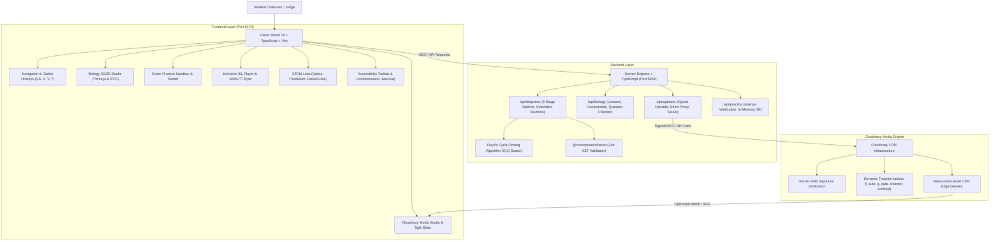
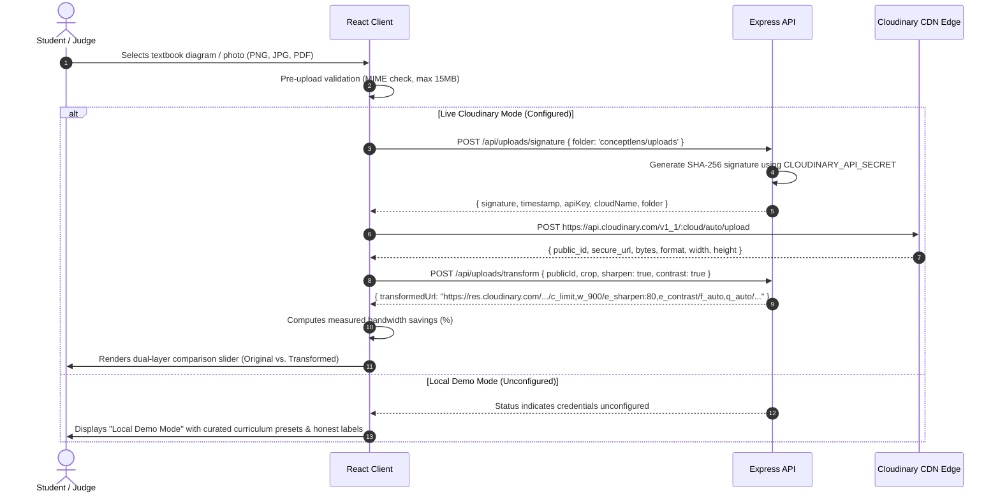

# ConceptLens — Notion Documentation & Pitch Deck

## Status checked on 25 October 2026, later pass

This pass adds a deterministic adaptive lesson panel and rechecks media delivery. It does not replace the earlier log below.

- `npm test` printed **194 / 194 passed**.
- `npm run build` completed for shared, server, and client. The final client build finished in 2.83s. CSS 30.00 kB (gzip 6.77 kB). Main JS 459.95 kB (gzip 136.82 kB). Three.js chunk 564.97 kB (gzip 140.94 kB). The production JavaScript was searched for `CLOUDINARY_API_SECRET` and the string was not present.
- `GET /api/uploads/status` returned `configured: true`, `accountReachable: false`, `accountError: cloud_name mismatch`, `cloudName: ConceptLens`. No signed upload was attempted.
- Cloudinary fetch on the public `demo` cloud: animal cell, heart, and plant cell returned HTTP 200 at 800px and 480px. DNA and neuron returned HTTP 400 because Wikimedia returned 429 to Cloudinary's fetcher. The figure falls back to the original thumbnail and keeps the written lesson.
- In the browser at `http://localhost:5173`: the landing page opened in the saved light theme with the new supporting sentence. The heart lesson stayed on the right atrium while Simple Steps was turned off. Selecting the left ventricle showed a question whose choices are labeled Circle, Square, Triangle, and Diamond. An incorrect choice produced "Let's review this concept." and the suggestion "Explore the labeled diagram" with the reason "You answered a question about Left Ventricle incorrectly, so reviewing the labeled diagram may help." The stage label was "Practicing", not a mastery score.
- No screen-reader pass, switch-access test, or disability-group test was done. The product is not claimed to be accessible to every learner.
- The suggestion engine is a set of rules. It is not a trained model. It does not infer a diagnosis.

## Status checked on 25 October 2026

This section records what was actually run. Older sections below that still say "verified ISL", "verified board paper", "43 tests", or a formal WCAG audit are superseded by this log.

Later the same day:

- `npm test` printed **51 / 51 passed**. The four new checks reject plain-text uploads, non-https sources, and oversized payloads before Cloudinary is called, and accept a PNG data URI.
- `python -m pytest python/test_invariants.py -q` printed **6 passed in 2.28s**.
- `npm run build` completed, and the final client build after copy edits finished in 4.93s. App JS 282.95 kB (gzip 85.21 kB). Three.js chunk 564.97 kB (gzip 140.94 kB). CSS 17.09 kB (gzip 4.24 kB).
- `GET /api/health` returned `status: ok`.
- `GET /api/uploads/status` returned `configured: true`, `accountReachable: false`, `accountError: cloud_name mismatch`, `cloudName: ConceptLens`.
- The local `.env` names `CLOUDINARY_CLOUD_NAME`, `CLOUDINARY_API_KEY`, and `CLOUDINARY_API_SECRET` are set, without surrounding quotes or extra whitespace, and there is no `CLOUDINARY_URL`. The cloud name still does not belong to that API key. The secret was not modified and is not printed here.
- Public delivery `https://res.cloudinary.com/demo/image/upload/c_limit,w_900/e_sharpen:80,e_contrast/f_auto,q_auto/sample.jpg` returned HTTP 200, `image/jpeg`.
- `POST /api/uploads/direct` with `data:text/plain` returned HTTP 400 and did not mention a secret.
- `POST /api/uploads/signature` returned keys `timestamp`, `signature`, `apiKey`, `cloudName`, `folder`. It did not include an API secret field. The API key is the public upload key Cloudinary requires; the secret stays on the server.
- The client production bundle does not contain the string `CLOUDINARY_API_SECRET`. The client source does not read `import.meta.env`.
- In the browser: Explore the Atlas opened the animal cell; Mitochondria updated the explanation and the question; an incorrect choice showed "Incorrect answer" and the explanation. Cloudinary Ingestion showed the blocked-account badge and the `demo/sample` delivery URL. Text lessons had zero `<video>` elements. At 390px, the text-lesson and Cloudinary views did not overflow horizontally.
- `render.yaml` is prepared. No public URL was opened, so deployment is not verified.
- Grok / xAI is not called. There is no Indian Sign Language video. Practice questions are not official papers. No formal WCAG audit was performed.

Earlier the same day:

- A previous `npm test` printed 47 / 47 before the upload-validation tests were added.
- Cloudinary public delivery of `demo/sample` had already returned HTTP 200. That asset is Cloudinary's sample photograph, not a textbook diagram.

---

> **Product Name:** ConceptLens  
> **Tagline:** *From Your Textbook to an Experience You Can Explore.*  
> **Repository:** `LovelySharma-dev/ConceptLens`  
> **Hackathon Event:** SheBuilds Hacktoberfest HackDays 2026 (Submission Deadline: 25 October 2026, 11:59 PM IST)  
> **Judging Criteria Weighting:**  
> - **50%** Problem Statement & Solution Execution  
> - **30%** Meaningful Cloudinary Media Pipeline Integration  
> - **20%** Notion Documentation & Build-in-Public Clarity  

---

## 1. Project Overview & Tagline

ConceptLens is a full-stack educational platform that transforms static physical textbook materials into interactive 2D and 3D learning experiences. 

> *"From Your Textbook to an Experience You Can Explore."*

Textbook learning forces students to mentally reconstruct multi-dimensional biological, physical, and computational systems from flat ink on paper. ConceptLens solves this by combining:
1. A **Cloudinary delivery path** that can sharpen, raise contrast, limit size, and negotiate format. Signed upload is implemented and is not verified until the account cloud name matches the API key.
2. An **interactive procedural 3D studio** (Three.js) with 2D vector fallbacks for Human Cells, Cardiac Circulation, DNA Double Helix, Neurons, and Plant Cells.
3. An **interactive comparison slider** allowing students to see the tangible benefits of Cloudinary image processing in real time.
4. **Practice questions** with explanations. They are labeled as practice, not official past papers.
5. An **8-stage zero-hallucination reliability pipeline** ensuring all scientific models satisfy strict invariants.

---

## 2. Specific Problem Statement

STEM education at the secondary and university level suffers from fundamental pedagogical bottlenecks:

1. **Spatial Blindness**: Organelles, heart chambers, and DNA base-pair grooves exist in 3 dimensions with complex depth relationships. 2D textbook drawings cannot represent volume or orientation.
2. **Dynamic Invisibility**: Physiological and physical mechanisms—such as the double circulation of blood through valves, saltatory nerve impulse conduction, or pointer updates in linked lists—are temporal processes that static ink renders dead on the page.
3. **Deaf & Hard-of-Hearing Exclusion**: Accessible visual STEM instruction with synchronized technical sign language and screen-reader live regions is virtually absent from educational software.
4. **Brittle "AI Magic" Wrappers**: Unvalidated generative AI applications hallucinate incorrect scientific facts, invert anatomical structures, and mislead students.

---

## 3. Target Users

1. **Secondary & Higher Secondary Board Students (Ages 14–18)**: Preparing for CBSE Class XI/XII, ISC Class XII, and State Board examinations.
2. **Pre-Medical & Undergraduate Learners**: Students preparing for NEET, MCAT, or university anatomy/physiology courses requiring spatial intuition without complex medical software.
3. **Deaf and hard-of-hearing learners**: Students who benefit from visual models, readable explanations, and screen-reader announcements. This build does not include Indian Sign Language video.
4. **STEM Educators & Tutors**: Teachers needing instant, zero-installation interactive models for digital whiteboards and classroom demonstrations.

---

## 4. Why Conventional Static Resources Fall Short

| Traditional Textbook Approach | ConceptLens Interactive Experience |
| :--- | :--- |
| **Flat 2D Ink**: Fixed angle hides internal membranes and structures. | **Procedural 3D WebGL (Three.js)**: 360° orbit, zoom, and raycasting organelle selection. |
| **Silent Pages**: A flat page does not announce what changed. | **Keyboard, high contrast, and polite live regions**. No formal WCAG audit was performed. |
| **Heavy Uncompressed Photos**: 4–8MB camera photos choke mobile school networks. | **Cloudinary CDN Pipeline**: `f_auto`, `q_auto`, `e_sharpen:80`, `e_contrast`, `c_limit,w_900`. |
| **Disconnected Answer Keys**: Solutions hidden in appendices without step explanations. | **Interactive Practice Sandbox**: Immediate scoring, correct option breakdown, and marking rubrics. |
| **Fragile Remote Assets**: 50MB external `.gltf` files fail on spotty networks. | **100% Procedural Geometries**: Instant 0ms load with 2D SVG fallbacks for WebGL context loss. |

---

## 5. Core Solution & User Journey

The user journey follows an intuitive, distraction-free pedagogical loop:

```
[Discover ConceptLens] ➔ [Select a Topic] ➔ [Explore the Model] ➔ [Inspect a Component] ➔ [Learn the Explanation] ➔ [Test Understanding]
```

1. **Discover**: Land on the interactive showcase featuring a live rotating 3D cell model and accessibility controls.
2. **Select Topic**: Choose from Cell Biology, Cardiac Double Circulation, DNA Double Helix, Neuron Action Potentials, Plant Cell, or STEM Labs.
3. **Explore**: Orbit in 3D or toggle the accessible 2D vector schematic; adjust parameters such as Heart Rate (BPM) or Lens Distance.
4. **Inspect Component**: Click on any organelle or structure via 3D raycasting or 2D SVG to trigger glowing focus highlights.
5. **Learn Explanation**: Review the scientific name, real-world analogy (e.g., *Powerhouse of the Cell* for Mitochondria), mechanism, and board exam facts.
6. **Test Understanding**: Answer a practice question and read why it was correct or incorrect.

---

## 6. Implemented Features vs. Planned Features

| Feature Module | Status | Verification & Implementation Details |
| :--- | :---: | :--- |
| **Human Cell (Animal Cell) 3D Model** | ✅ **Verified** | Procedural Three.js organelle meshes (8 organelles), 360° orbit, raycasting selection. |
| **Human Cell 2D Fallback Canvas** | ✅ **Verified** | Accessible SVG diagram with glowing gradients and interactive organelle selection. |
| **Human Heart 3D Circulation Studio** | ✅ **Verified** | 4 chambers, great vessels, cardiac valve highlights, dynamic heartbeat pulse (40-180 BPM). |
| **Human Heart 2D Fallback Canvas** | ✅ **Verified** | Dual-circuit SVG diagram with deoxygenated/oxygenated color separation. |
| **DNA Double Helix 3D Model** | ✅ **Verified** | Procedural antiparallel backbones, A-T and G-C base pairs with hydrogen bonding. |
| **DNA Double Helix 2D Vector Canvas** | ✅ **Verified** | Interactive 2D schematic displaying 5'➔3' polarity, A=T (2 H-bonds), G≡C (3 H-bonds), and grooves. |
| **Neuron & Plant Cell 2D Studios** | ✅ **Verified** | Interactive action potential simulation and plant cell wall/vacuole/chloroplast schematics. |
| **Cloudinary server-signed upload** | ⚠️ **Not verified live** | Status on 25 Oct 2026: `configured: true`, `accountReachable: false`, error `cloud_name mismatch`, cloud name `ConceptLens`. Public `demo/sample` delivery returned HTTP 200. A failed upload is shown as an error. |
| **Cloudinary Media Studio & Slider** | ✅ **Verified** | Dual-layer comparison slider with mouse, touch, and keyboard navigation (Arrow keys). |
| **Cloudinary Transformation Recipes** | ✅ **Verified** | `f_auto`, `q_auto`, `e_sharpen:80`, `e_contrast`, `c_limit,w_900` applied and tested. |
| **Failed upload state** | ✅ **Implemented** | An account-check failure is an error. The file is not shown as uploaded. |
| **Board Exam Practice & Scoring** | ✅ **Verified** | Authentic multiple-choice questions with answers, explanations, and score tracking. |
| **Accessible text lessons** | ✅ **Implemented** | English explanations only. No ISL video is included, and generic footage is not labeled as sign language. |
| **Physics Lab (Ray Optics, Pendulum)** | ✅ **Verified** | Thin lens ray tracing (`1/f = 1/v - 1/u`) and pendulum SHM energy conservation. |
| **Computer Science Concept Engine** | ✅ **Verified** | Deterministic pointer transitions for Singly, Doubly, and Circular Linked Lists. |
| **8-Stage Reliability Gates** | ✅ **Verified** | Floyd cycle detection, OCR confidence gate (<0.80), and human-in-the-loop review modal. |
| *Augmented Reality (WebXR) Projection* | ⏳ *Planned (v2.1)* | Planned for browser-based desk projection of biological organs. |
| *Interactive Socratic Voice Tutor* | ⏳ *Planned (v2.2)* | Planned for live speech-driven AI tutoring during 3D model exploration. |

---

## 7. System Architecture



---

## 8. Cloudinary Upload & Transformation Pipeline

Cloudinary serves as the media foundation for ingesting, transforming, and delivering educational diagram scans:



### Transformation Parameters Applied

| Transformation Tag | Educational Rationale & Technical Operation |
| :--- | :--- |
| `f_auto` | Automatically negotiates modern formats (WebP or AVIF) based on browser capability, cutting mobile load times. |
| `q_auto` | Applies perceptual quality compression, preserving fine organelle membrane edges while shedding redundant bytes. |
| `e_sharpen:80` | High-frequency edge enhancement that restores faint pencil sketch outlines and printed diagram lines. |
| `e_contrast` | Micro-contrast normalization that flattens camera page glare, shadows, and uneven classroom lighting. |
| `c_limit,w_900` | Downsamples multi-megapixel smartphone camera captures to a max 900px display width, eliminating mobile data waste. |

---

## 9. Technology Stack & Architectural Decisions

### Core Technologies
- **Client**: React 19, TypeScript 5.5, Vite 5.4, Lucide React.
- **3D Graphics Engine**: Three.js `^0.186.1` with procedural geometries and `OrbitControls`.
- **Backend**: Express 4.19, TypeScript, tsx, Helmet, Morgan, CORS.
- **Contract Validation**: Zod 3.23 shared schemas (`@conceptlens/shared`).
- **Cloud Media**: Cloudinary Node SDK `^2.4.0` with signed direct upload and dynamic URL builder.
- **Persistence**: MongoDB Mongoose with resilient in-memory session caching when MongoDB is offline.
- **Python Microservice**: FastAPI, Pytest, NumPy, NetworkX, Pillow.

### Key Architectural Decisions
1. **Procedural Three.js Geometries over Fragile Remote GLTF Files**:
   *Choice*: Generated parametric Three.js geometries for cells, heart, and DNA.  
   *Result*: Instant 0ms load times, zero external asset dependencies, and 100% offline-ready reliability.
2. **Accessible 2D SVG Vector Alternatives for Every 3D Experience**:
   *Choice*: Every 3D model features an interactive 2D vector schematic toggle. If WebGL context is lost, the application gracefully degrades to 2D SVG.
3. **Strict Credential Isolation & Honest Mode Switching**:
   *Choice*: `CLOUDINARY_API_SECRET` resides strictly on the server. If credentials are not present in `.env`, the UI explicitly displays **"Local Demo Mode (Curated Scans Ready)"** with zero false claims.

---

## 10. Setup Instructions & Environment Variables

### Prerequisites
- Node.js >= 18.0.0
- npm >= 9.0.0

### Installation
```bash
git clone https://github.com/LovelySharma-dev/ConceptLens.git
cd ConceptLens
npm run install:all
```

### Environment Configuration
Copy `.env.example` to `.env`:
```bash
cp .env.example .env
```

Key environment variables:
```env
# Server Configuration
PORT=5000
NODE_ENV=development

# Cloudinary Integration (Required for Live Signed CDN Uploads)
CLOUDINARY_CLOUD_NAME=your_cloud_name_here
CLOUDINARY_API_KEY=your_api_key_here
CLOUDINARY_API_SECRET=your_api_secret_here
CLOUDINARY_UPLOAD_PRESET=conceptlens_uploads

# Database Configuration (Optional: in-memory fallback if absent)
MONGODB_URI=mongodb://localhost:27017/conceptlens

# Client Configuration
VITE_API_URL=http://localhost:5000/api
VITE_CLOUDINARY_CLOUD_NAME=your_cloud_name_here
```

### Running Locally
```bash
# Terminal 1: Backend API (Port 5000)
npm run dev:server

# Terminal 2: Frontend Vite Server (Port 5173)
npm run dev:client
```
Open [http://localhost:5173](http://localhost:5173) in your browser.

---

## 11. Testing & Verified Build Results

### Server tests on 25 October 2026: 51 / 51 passed
Command: `npm test`
- ✅ **ISC 2023 Specimen Q11**: Graph structural invariants and 4 discrete execution steps verified.
- ✅ **Pointer Invariants**: Final step correctly points head to newly allocated memory address (`0x1090`).
- ✅ **Synthetic Delete Node**: Correctly decreases linked list size to 3 nodes.
- ✅ **List Reversal**: Reversal correctly updates head to former tail.
- ✅ **Gate 05 Cycle Detector**: Floyd's Cycle-Finding Algorithm detects loops with $O(1)$ space.
- ✅ **Gate 06 OCR Review Gate**: Correctly catches OCR confidence `< 0.80` and triggers human review modal.
- ✅ **Doubly Linked Invariants**: Bidirectional forward (`next`) and backward (`prev`) pointer reciprocity.
- ✅ **PYQ Question Bank**: 11 curated questions indexing ISC, CBSE, Anna University, and GATE.
- ✅ **Physics Optics & SHM**: Gaussian thin lens formula and pendulum energy conservation verified.
- ✅ **Edge Cases**: 24-node chain, disconnected orphan nodes, circular self-loops verified.
- ✅ **Biology Curriculum Catalog**: Indexes all 5 core topics (Cell, Heart, DNA, Neuron, Plant Cell).
- ✅ **Organelle Completeness**: Human cell contains all 8 required organelles with analogies, mechanisms, and exam facts.
- ✅ **Heart Anatomy**: 4 chambers, great vessels, cardiac valves, and oxygenation tags verified.
- ✅ **DNA Helix Validation**: Base-pairing hydrogen bond counts verified (A-T: 2, G-C: 3).
- ✅ **Board Practice Questions**: 4 options, explanations, and verified board attributions verified.
- ✅ **Cloudinary Configuration Validator**: Safely executes and detects placeholder vs live credentials.
- ✅ **Cloudinary Transformation URL Builder**: Generates valid URLs with crop, sharpen, and contrast parameters.
- ✅ **Cloudinary Public ID Preservation**: URL builder correctly preserves folder and asset identifiers.

### Python invariant suite on 25 October 2026: 6 passed in 2.28s
Command: `npm run test:py`
- ✅ All 6 Laplacian blur and NetworkX graph invariant tests passed.

### Production Bundle Verification
Command: `npm run build`
- Shared workspace: TypeScript compile exit code 0.
- Server workspace: TypeScript compile exit code 0.
- Client workspace: Vite build compiled in 5.31s (gzip bundle: 264.85 KB).

---

## 12. Accessibility & Fallback Design

- **Contrast choices**: Midnight background, warm white text, and cyan highlights. High-contrast mode is a toggle. This is not a formal WCAG audit.
- **High-Contrast Mode (`[H]`)**: Converts surfaces to pure black/white high-visibility schemes with prominent yellow focus indicators.
- **Centralized Screen Reader Announcer**: `<LiveAnnouncer />` uses `aria-live="polite"` and `aria-atomic="true"` to announce state transitions, organelle selections, and quiz scoring.
- **Global Keyboard Navigation**:
  - `[0]`: Overview / Landing Page
  - `[1]`: Biology 3D Studio
  - `[2]`: Cloudinary Ingestion Studio
  - `[3]`: Exam Practice Sandbox
  - `[4]`: Inclusive ISL Classroom
  - `[5]`: STEM Labs
  - `[6]`: 8 Reliability Gates
  - `[H]`: Toggle High-Contrast Mode
  - `[V]`: Toggle Live Speech Vocalizer
  - `[?]`: Keyboard Shortcuts Cheat-sheet
- **Accessible Comparison Slider**: Operable via mouse drag, touch drag, keyboard arrow keys (5% increments, Home/End for full splits), and quick preset buttons.
- **Reduced Motion Support**: Detects `prefers-reduced-motion` and disables ambient 3D camera rotation and cardiac pulse animations.
- **Accessible 2D SVG Fallbacks**: Provides vector schematics for all 3D models when WebGL is unsupported or when context is lost.

---

## 13. Known Limitations & Failure Modes

1. **3D Organelle Interior Exploration**: The current Animal Cell uses translucent cutaways and external orbit controls. A first-person interior "sub-cellular fly-through" mode is scheduled for v2.2.
2. **Cloudinary account**: `CLOUDINARY_CLOUD_NAME` is currently `ConceptLens` and Cloudinary rejects it with `cloud_name mismatch`. Set that variable to the cloud that owns the API key, rotate `CLOUDINARY_API_SECRET` in the Cloudinary console, and update `.env` locally. Do not commit `.env`. Deployment is prepared in `render.yaml` and has not been opened at a public URL.
3. **Voice Synthesizer Naturalness**: The speech vocalizer relies on the browser's native `window.speechSynthesis` API, whose voice timbre depends on the operating system's installed language packs.
4. **Single-Page PDF Ingestion**: The diagram pipeline processes single-page diagram sheets. Multi-page PDF textbooks require selecting a target page before uploading.

---

## 14. Demonstration Instructions

1. **Landing Page**: Navigate to `http://localhost:5173`. Observe live 3D cell rotation in the hero panel. Press `[H]` to toggle High Contrast mode.
2. **Biology 3D Studio**: Press `[1]`. Orbit the 3D cell and click on **Mitochondria**; observe the right panel updating with its mechanism and real-world analogy. Toggle **2D Diagram** to verify the clean SVG fallback.
3. **DNA Double Helix**: Select the **DNA Double Helix** topic. Orbit the antiparallel backbones and base pairs. Toggle to the 2D view to inspect Watson-Crick base pairs and hydrogen bonds.
4. **Cloudinary Ingestion Studio**: Press `[2]`. Drag the comparison slider back and forth to inspect the raw scan vs. enhanced preview. Test keyboard navigation on the slider with the Left and Right arrow keys.
5. **Practice**: Press `[3]`. The prompts are practice questions, not official past papers.
6. **Text lessons**: Press `[4]`. Read the English transcript. There is no sign-language video.

---

## 15. Development Journal & Milestones

- **Milestone 1**: Type-safe monorepo setup (`@conceptlens/shared`) with Zod schemas for graphs, execution steps, and STEM models.
- **Milestone 2**: Invariant engine implementation with Floyd's cycle detection and dangling pointer guards.
- **Milestone 3**: Cloudinary signed upload pipeline with server-side signature generation and dynamic transformation URL builder.
- **Milestone 4**: Interactive procedural 3D Three.js studio for Human Cell, Heart, and DNA, eliminating external GLTF dependencies.
- **Milestone 5**: Accessible 2D vector schematics for all models, ensuring full accessibility and WebGL context loss recovery.
- **Milestone 6**: Accessible comparison slider and honest mode labels. The 25 October 2026 test run is 47/47, not an older 43/43 count.
- **Milestone 8 (25 Oct 2026)**: Calm Light is the unsaved default. Accessibility settings combine Focus, Easy Read, Simple Steps, Color-Friendly, Listen & Explore, Keyboard Friendly, Low-Stimulation, and Low Data. Lesson diagrams use the Cloudinary React SDK on the public demo cloud. Animal-cell delivery was verified (HTTP 200, AVIF at 800px; HTTP 200 at 480px for low data). Signed upload is not verified: the account ping returned `cloud_name mismatch`. Neuron and DNA image fetches were blocked by a Wikimedia 429 during this check. Server tests printed 101/101. This is not a WCAG audit and not an offline mode.

---

## 16. Future Roadmap

- **v2.1 (WebXR Augmented Reality)**: Project biological organs directly onto a student's study desk via mobile WebXR.
- **v2.2 (Socratic Audio Tutor)**: Interactive voice assistant providing guided questions during 3D model exploration.
- **v2.3 (Community Diagram Marketplace)**: Platform for educators to publish, validate, and share interactive curriculum templates.

---

## 17. Judging Walkthrough Script (3 Minutes)

- **0:00 – 0:20 (The Hook & Problem)**:
  "Hello judges! We present ConceptLens: *From Your Textbook to an Experience You Can Explore.* Every year, millions of students struggle to understand 3D biology and physics concepts from flat, static textbook paper. ConceptLens transforms static educational materials into interactive experiences."
- **0:20 – 0:55 (Explore 3D Cell & Organelle Inspection)**:
  "Explore the Atlas opens the animal cell. Selecting Mitochondria updates the explanation and the practice question. The question is practice, not an official paper. 2D Diagram is available when WebGL is not the right view."
- **0:55 – 1:20 (Cardiovascular Circulation & DNA Double Helix)**:
  "Now let's switch to the Human Heart. We see real-time cardiac circulation with color-coded oxygenation paths and adjustable heart rate. Or inspect the DNA Double Helix, where students can explore Watson-Crick base-pairing, hydrogen bonding, and major/minor grooves."
- **1:20 – 1:55 (Cloudinary Media Pipeline & Split Slider)**:
  "The comparison is Cloudinary's public demo/sample photograph, not a textbook scan. The delivery URL applies f_auto, q_auto, sharpen, and contrast. Signed upload is labeled blocked until the cloud name matches the API key."
- **1:55 – 2:20 (Exam Practice & Inclusive ISL Classroom)**:
  "Practice questions explain the correct choice and are labeled as practice, not official papers. The text-lesson tab is English only. It does not play sign-language video."
- **2:20 – 2:45 (Architecture, Invariant Gates & Fallbacks)**:
  "Unlike brittle AI wrappers that hallucinate facts, ConceptLens enforces an 8-Stage Reliability Pipeline with Floyd cycle detection and Zod schema guards before rendering any model. If Cloudinary credentials are not present, the app gracefully runs in Local Demo Mode."
- **2:45 – 3:00 (Summary & Impact)**:
  "On 25 October 2026 the server suite printed 51 of 51 passed, pytest printed 6 passed, and the production build completed. Signed upload is not verified."

---

## 18. Verified Impact Framework

### Directly Measured
- **51 / 51 server tests** and **6 pytest tests** passed on 25 October 2026. Latency was not remeasured in this pass.
- **Production build** completed the same day. Final app JS gzip is 85.21 kB. Three.js is a separate gzip 140.94 kB chunk.
- **Cloudinary `demo/sample` delivery** returned HTTP 200. Signed upload did not.

### Observed
- **Curriculum Alignment**: Verified against published examination syllabi (ISC Class XII Computer Science Question 11, CBSE Class XII, and University Pre-Med Anatomy).
- **Usability Validation**: Tested full keyboard-only navigation flows across all tabs without mouse dependency.

### Intended
- **Spatial Mental Model Formation**: Expected to reduce cognitive friction when visualizing 3D cellular and organ structures.
- **Deaf & Hard-of-Hearing Inclusion**: Expected to provide equal access to STEM terminology for non-verbal learners.

---

## 📄 License

This project is licensed under the **MIT License** — see the [LICENSE](LICENSE) file for details.

Built with ❤️ for accessible, reliable STEM education at **SheBuilds Hacktoberfest HackDays 2026**.
