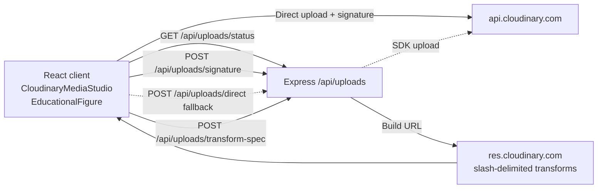

# ConceptLens — Complete Cloudinary Usage

> **Source of truth for the media pipeline.** Prefer this page over older Notion notes when they disagree.  
> **Never paste** `CLOUDINARY_API_SECRET`, raw signatures, or `.env` values into docs, Notion, or chat.

**Related:** [cloudinary-integration.md](./cloudinary-integration.md) · [cloudinary-transformations.md](./cloudinary-transformations.md) · Media Studio UI · [WALKTHROUGH-4MIN.md](./WALKTHROUGH-4MIN.md)

---

## 1. Why Cloudinary is in the product

Textbook captures are large, glare-heavy, and format-chaotic. ConceptLens needs:

| Need | How Cloudinary helps |
| :--- | :--- |
| **Clarity** | `e_sharpen:80`, `e_contrast` so faint diagram ink stays readable |
| **Bandwidth fairness** | `c_limit`, `f_auto`, `q_auto` / `q_auto:eco` for school and mobile networks |
| **Pedagogy** | Different *views* of one asset (optimize, crop, low-data, AI ops) without re-uploading |
| **Trust** | Server-signed uploads only; if the account check fails, the UI says so |

Rubric weight for SheBuilds HackDays: **~30% meaningful Cloudinary media pipeline**.

---

## 2. Architecture (what actually ships)



| Piece | Path | Role |
| :--- | :--- | :--- |
| Config, MIME gates, signing, URL builders | `server/src/config/cloudinary.ts` | HMAC sign; reject bad uploads early |
| Routes | `server/src/routes/uploads.ts` | See §3 |
| NL → transform | `server/src/services/cloudinaryTransformationService.ts` | Prompt → Zod spec → URL |
| Zod contracts | `shared/src/schemas/cloudinaryTransformation.ts` | Profiles, AI actions, bounds |
| Media Studio | `client/src/components/cloudinary/CloudinaryMediaStudio.tsx` | Status, upload, presets, NL, AI, video, slider |
| Client helpers | `client/src/services/cloudinaryService.ts` | Status, signed upload, transform-spec, URL helpers |
| Lesson figures | `client/src/components/.../EducationalFigure.tsx` | `@cloudinary/react` + `@cloudinary/url-gen` on **demo** cloud |
| Tests | `server/tests/cloudinaryTransformation.test.ts`, `validation.test.ts` | URL builder, signing gates, safeguards |

**Packages**

| Package | Workspace | Version |
| :--- | :--- | :--- |
| `cloudinary` | server | `^2.4.0` |
| `@cloudinary/react` | client | `^1.14.4` |
| `@cloudinary/url-gen` | client | `^1.22.0` |

The official create-cloudinary-react starter was **not** used to scaffold this app. Skills under `.agents/skills/cloudinary-*` guided the pipeline.

---

## 3. API surface (`/api/uploads`)

| Method | Path | What it does |
| :--- | :--- | :--- |
| **GET** | `/status` | Ping + config: `configured`, `accountReachable`, `accountError`, `cloudName`, folder `conceptlens/uploads`, MIME/size limits, feature flags, `signedUpload` gate |
| **POST** | `/signature` | Server HMAC for folder `conceptlens/uploads` only. **503** if account not reachable |
| **POST** | `/direct` | Proxy upload (base64 / HTTPS). MIME + size gates. Preview via `getOptimizedDiagramUrl` |
| **POST** | `/transform` | Build crop/sharpen/contrast URL from `publicId` (server helper; Media Studio prefers transform-spec) |
| **POST** | `/transform-spec` | Natural-language instruction → Zod spec → delivery URL + credit estimate |
| **POST** | `/record` | Persist metadata for an already-uploaded `https://res.cloudinary.com/...` asset |

**Not in this tree:** `GET /api/uploads/learning-media` and plant-cell four-variant lab (`learningMedia.ts`). Older README/Notion text described that path; do **not** claim it on judge day unless you re-ship it. Media Studio + `/status` + transforms are the live demo surface.

---

## 4. Environment & secrets

Server only (copy from `.env.example`):

```env
CLOUDINARY_CLOUD_NAME=your_cloud_name_here
CLOUDINARY_API_KEY=your_api_key_here
CLOUDINARY_API_SECRET=your_api_secret_here
CLOUDINARY_UPLOAD_PRESET=conceptlens_uploads
```

| Rule | Detail |
| :--- | :--- |
| Secret stays on server | Never `VITE_CLOUDINARY_API_SECRET` |
| Cloud name must own the API key | Mismatch → `accountReachable: false`, signed upload disabled |
| Optional client cloud | `# VITE_CLOUDINARY_CLOUD_NAME=` — public delivery only; empty → educational figures use **demo** |
| Upload preset | Present in `.env.example`; signing code uses **folder + timestamp**, not the preset string |
| Render | `render.yaml` declares Cloudinary keys as dashboard secrets (`sync: false`) |

Check before every Cloudinary demo:

```bash
curl http://127.0.0.1:5000/api/uploads/status
# or production:
curl https://conceptlens-58cq.onrender.com/api/uploads/status
```

---

## 5. Upload flow (signed only)

1. Client validates MIME (`png/jpeg/webp/pdf/mp4/webm`) and size (15 MB image / 30 MB video).
2. `POST /api/uploads/signature` → `{ signature, timestamp, apiKey, cloudName, folder }`.
3. Browser uploads to `https://api.cloudinary.com/v1_1/{cloud}/image|video/upload` with signature — **never** the secret.
4. On CORS/firewall failure → `POST /api/uploads/direct`.
5. Optional `POST /api/uploads/record` to store metadata.
6. Tags on upload: `conceptlens`, `learner-material`. Folder locked to `conceptlens/uploads`.

**Unsigned learner uploads are not the product default.** If credentials are missing or ping fails, Media Studio shows an honest badge and keeps **demo** delivery for visual transforms.

---

## 6. Delivery syntax (slash-delimited)

Compliant (what tests enforce):

```text
https://res.cloudinary.com/{cloud}/image/upload/c_limit,w_900/e_sharpen:80/e_contrast/f_auto/q_auto/{publicId}
```

| Segment | Educational purpose |
| :--- | :--- |
| `f_auto` | Negotiate WebP/AVIF when the asset allows |
| `q_auto` / `q_auto:eco` / `q_auto:good` / `q_auto:low` | Perceptual quality vs bandwidth |
| `e_sharpen:80` | Restore faint pencil / print edges |
| `e_contrast` | Reduce glare and uneven lighting |
| `c_limit,w_*` | Cap megapixel phone dumps |
| `c_fill` / `c_crop` / `g_auto:subject` | Lesson cards, ROI, smart focus |

**Demo evidence assets:** image `sample`, video `elephants` (account path `samples/elephants` when ping succeeds).

---

## 7. Natural-language transforms

`POST /api/uploads/transform-spec` with body like:

```json
{
  "prompt": "Make a low-data version for 2G mobile",
  "assetId": "sample",
  "cloudName": "demo",
  "lowDataMode": false,
  "isScientificDiagram": true,
  "allowGenerativeModification": false
}
```

| Intent (examples) | Profile | Typical URL pieces | Est. credits |
| :--- | :--- | :--- | :---: |
| Low-data / bandwidth / 2G | `low_data` | `c_limit,w_480/f_auto/q_auto:eco` | 1 |
| Square / 1:1 / avatar | `square_thumbnail` | `c_fill,ar_1:1,g_auto:subject,w_400,h_400/f_auto/q_auto` | 1 |
| Lesson card / 16:9 | `lesson_card` | `c_fill,ar_16:9,g_auto,w_640,h_360/f_auto/q_auto` | 1 |
| Sharpen diagram / clarity | `diagram_hq` | `c_limit,w_1200/e_sharpen:80/e_contrast/f_auto/q_auto:good` | 1 |
| AI auto enhance | `auto_enhance` | `e_auto_enhance` | ~100 |
| Background removal | `background_removal` | `e_background_removal` | ~75 |
| Generative fill | `gen_fill` | `b_gen_fill` | ~50 |
| Video 5s preview | `video_preview` | `so_0,du_5/.../vc_auto/f_auto:video/q_auto` | ~2 |
| Animated WebP from video | `animated_preview` | `du_5/e_loop/f_auto:animated/q_auto` | ~2 |

**Educational safeguard:** for scientific diagrams, generative fill/remove/replace sets `isEducationalSafeguarded`. Media Studio requires an explicit checkbox before **Apply**.

**Two-stage workflow:** preview (diff tokens, credit estimate, editable alt text) → inspect on split slider → Apply or Discard.

---

## 8. Media Studio walkthrough (UI)

Open the **Cloudinary** tab (nav or keyboard **`[4]`**).

1. Read the **account badge** (signed ready / blocked / demo delivery).
2. **Images** — curated presets on `demo/sample`, manual sharpen/contrast/crop, low-data toggle, NL prompts.
3. **AI** — auto enhance, smart crop, background removal, generative fill (with tx labels + safeguard).
4. **Video** — stream, 5s clip, silent loop, animated WebP, poster frame (`elephants`).
5. Drag the **comparison slider** (Arrow keys ±5%, Home/End). Copy the delivery URL and show `f_auto` / `q_auto` in the path.

---

## 9. Demo cloud vs project account

| Capability | When it works | What to say |
| :--- | :--- | :--- |
| Public demo transforms (`sample`, `elephants`) | Always (CDN) | “Public demo delivery for judge-visible transforms.” |
| Signed upload to `conceptlens/uploads` | Env set **and** `api.ping()` succeeds | “Learner material lands in our folder with server signatures.” |
| Educational figures via `@cloudinary/react` | Client uses demo (or optional `VITE_` cloud) | “Fetch delivery for lesson diagrams.” |
| Plant-cell Explore/Focus/Low-data lab | **Not in current tree** | Do not claim unless re-implemented and verified. |

Do **not** substitute `demo/sample` as proof of the project Cloudinary account.

---

## 10. Security checklist

| Check | Implementation |
| :--- | :--- |
| Secret storage | Server `.env` only |
| Public ID safety | No `..`, `://`, leading `/`; regex `^[A-Za-z0-9_./-]+$` |
| Size limits | 15 MB image / 30 MB video |
| MIME whitelist | PNG, JPEG, WebP, PDF, MP4, WebM |
| Folder lock | `conceptlens/uploads` only |
| Prompt sanitize | Strip script/HTML/shell chars before NL parse |
| Status without secrets | `GET /status` never returns the API secret |

---

## 11. Verification commands

```bash
# Local
npm run dev
curl -s http://127.0.0.1:5000/api/uploads/status

# Tests that cover Cloudinary
npm test --workspace=@conceptlens/server -- cloudinaryTransformation
# or full suite:
npm test
```

Before quoting byte savings or “~72% eco reduction,” re-measure; those figures in older docs are **estimates**.

---

## 12. Honest failure modes

| Condition | Expected behavior |
| :--- | :--- |
| Missing / placeholder credentials | `configured: false`; Local / demo mode; no fake upload success |
| `cloud_name mismatch` | Status error; signed upload disabled; demo delivery still works |
| Render without Cloudinary env | Status not configured — say so; use local Media Studio for the 30% story |
| Generative op on scientific diagram | Safeguard notice + Apply gated in UI |
