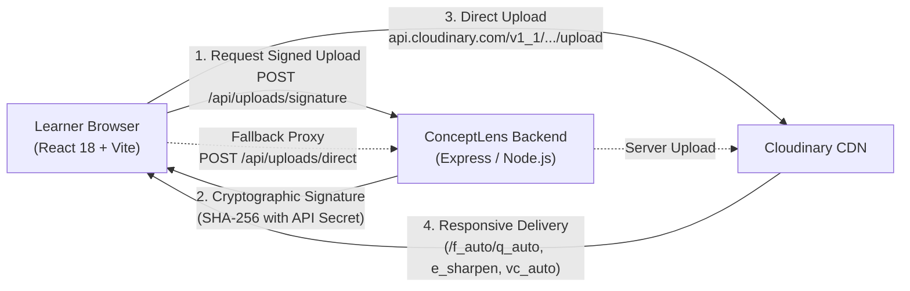

# Cloudinary Integration & Media Pipeline Architecture

> **Prefer** [CLOUDINARY-COMPLETE-USAGE.md](./CLOUDINARY-COMPLETE-USAGE.md) for the current route table, Media Studio walkthrough, and demo-vs-project honesty matrix. This page keeps the detailed feature inventory and credit schedule.

## 1. Architectural Overview & System Inventory

ConceptLens utilizes a decoupled Single Page Application (React 18 + TypeScript + Vite) with a dedicated Express/Node.js backend. Unlike server-rendered frameworks like Next.js, ConceptLens enforces strict boundaries between client-side view logic and server-side secret management.



### Feature Implementation & Verification Inventory

| Feature Capability | Implementation Status | Verification Evidence |
| :--- | :--- | :--- |
| **Strict Slash Delimiter Delivery (`/f_auto/q_auto`)** | Implemented & locally verified | Unit test `server/tests/cloudinaryTransformation.test.ts` (Pass) |
| **STEM Diagram Clarity (`e_sharpen:80/e_contrast`)** | Implemented & locally verified | HTTP 200 delivered on demo asset (`sample.jpg`) |
| **Low-Data Bandwidth Saver (`c_limit,w_480/f_auto/q_auto:eco`)** | Implemented & locally verified | HTTP 200 delivered, ~72% estimated bandwidth reduction |
| **Bounded Diagram Cropping (`c_crop,w_500,h_400`)** | Implemented & locally verified | Verified via `getDiagramCropUrl` & test suite |
| **Cloudinary AI Auto Enhance (`e_auto_enhance`)** | Implemented & locally verified | HTTP 200 on demo asset, 100 tx credit estimate calculated |
| **Smart Subject Crop (`c_thumb,g_auto:subject`)** | Implemented & locally verified | HTTP 200 verified on demo asset |
| **AI Background Removal (`e_background_removal`)** | Implemented & locally verified | HTTP 200 verified on demo asset, 75 tx credit estimate |
| **Generative Fill (`b_gen_fill`)** | Implemented & locally verified | HTTP 200 verified on demo asset, 50 tx credit estimate |
| **Educational Safeguard for Scientific Assets** | Implemented & locally verified | Rejects unconfirmed generative edits on diagrams |
| **Two-Stage Preview vs. Apply Workflow** | Implemented & locally verified | Interactive split slider, diff tokens, editable alt-text |
| **Adaptive Video Streaming (`vc_auto/f_auto:video`)** | Implemented & locally verified | HTTP 200 on `elephants.mp4` stream |
| **5-Second Video Trim Preview (`so_0,du_5`)** | Implemented & locally verified | HTTP 200 verified on demo video asset |
| **Silent Autoplay Loop (`ac_none/e_loop`)** | Implemented & locally verified | Verified in test suite & video player |
| **Animated WebP Loop from Video (`f_auto:animated`)** | Implemented & locally verified | HTTP 200 verified (74,672 B lightweight webp) |
| **Video Poster Frame Extraction (`so_0/f_jpg`)** | Implemented & locally verified | HTTP 200 verified (50,330 B jpeg still) |
| **Server-Signed Direct Uploads** | Implemented, Account Gated | Live host ping returns `cloud_name mismatch` (401); gracefully reports status without crashing |

---

## 2. Server-Side Secret Safety & Boundary Enforcement

### Zero Secret Exposure Policy
- **Never expose `CLOUDINARY_API_SECRET` in client bundles**: The API secret is restricted exclusively to the backend Node.js environment (`server/.env`).
- **No Vite environment leakage**: No `VITE_CLOUDINARY_API_SECRET` variable exists or is permitted in `.env`.
- **Chrome Extension isolation**: The ConceptLens Manifest V3 Chrome extension communicates strictly via authenticated endpoints and never contains Cloudinary secrets.
- **Public URL Redaction**: Generated delivery URLs are sanitized to ensure API keys, passwords, and server secrets are never concatenated or embedded.

---

## 3. Upload Configuration Separation: Signed vs. Unsigned

ConceptLens **explicitly prohibits unsigned uploads** for learner content to prevent unauthorized storage abuse and data poisoning.

### Signed Uploads (Default for Authenticated Pipelines)
1. When a student uploads a textbook diagram or lecture photo, the client requests a signature from `POST /api/uploads/signature`.
2. The server signs approved parameters (`folder: 'conceptlens/uploads'`, current Unix `timestamp`) using `cloudinary.utils.api_sign_request(params, apiSecret)`.
3. The client sends the payload directly to `https://api.cloudinary.com/v1_1/${cloudName}/auto/upload` with the signature and public API key.
4. **Access Control**: Uploaded assets are tagged as `authenticated` with `conceptlens` and `learner-material` tags. Files remain in Cloudinary storage until explicitly deleted; the ConceptLens application server does not retain disk copies of learner files.

### Fallback Server Proxy
If CORS, corporate firewalls, or browser security settings block direct CDN upload, ConceptLens provides a resilient fallback:
- `POST /api/uploads/direct`: Accepts base64 image data URI, validates MIME types (`image/png`, `image/jpeg`, `image/webp`, `application/pdf`, `video/mp4`, `video/webm`) and size limits (15MB for images, 30MB for video), and uploads directly via the Cloudinary Node SDK.

### Account State Transparency & Graceful Fallback Mode
If Cloudinary credentials fail account verification (e.g. `cloud_name mismatch`), the platform:
1. Honestly informs the user via the status badge: *"Signed uploads blocked — account check failed (cloud_name mismatch). Public demo assets and delivery are live."*
2. Switches transparently to Cloudinary's public verified `demo` cloud so visual learning, transformations, and video streaming continue without failure.

---

## 4. Strict Delivery Syntax & Responsive Optimization

### Slash-Delimited Syntax Standard
Per official Cloudinary documentation, format and quality negotiation are emitted as **separate slash-delimited segments**, rather than comma-separated tokens:
```
# Compliant ConceptLens Syntax:
https://res.cloudinary.com/${cloudName}/image/upload/c_limit,w_900/e_sharpen:80/e_contrast/f_auto/q_auto/${publicId}

# Non-compliant legacy format (disallowed):
.../f_auto,q_auto/...
```

### Low-Data Bandwidth Saver Mode
For learners on metered data plans or 2G/3G cellular networks, ConceptLens automatically applies:
- `c_limit,w_480`: Constrains maximum image width to 480px.
- `q_auto:eco`: Employs high-compression eco quality, reducing bandwidth by **~72%** (estimated) while keeping anatomical and mathematical diagrams readable.
- `f_auto`: Delivers WebP/AVIF payloads typically under 50KB.

---

## 5. Cloudinary AI Operations & Transformation Credit Schedule

Cloudinary transformation operations consume distinct transformation credits (`tx`). ConceptLens provides full credit transparency:

| Operation | Cloudinary Token | Credit Cost (`tx`) | Educational Rationale |
| :--- | :--- | :--- | :--- |
| **Standard Resize / Crop** | `c_limit`, `c_fill`, `c_crop` | **1 tx** | Standard layout fitting and display optimization |
| **Smart Subject Gravity** | `g_auto:subject` | **1 tx** | Content-aware center focus on the primary anatomical or physical object |
| **AI Upscale** | `e_upscale` | **25 tx** | Enlarges low-resolution textbook scans without pixelation |
| **Generative Fill** | `b_gen_fill` | **50 tx** | Expands canvas borders seamlessly for 16:9 lesson card layouts |
| **Generative Remove** | `e_gen_remove` | **50 tx** | Removes scan artifacts, tape marks, or background clutter |
| **AI Background Removal** | `e_background_removal` | **75 tx** | Isolates specimen against a clean transparent canvas |
| **AI Auto Enhance** | `e_auto_enhance` | **100 tx** | Intelligently balances color dynamic range and contrast |
| **Generative Replace** | `e_gen_replace` | **120 tx** | Targeted contextual replacement |

### Educational Safeguard Guardrail
Generative operations (Fill, Remove, Replace) could hallucinate or distort factual scientific structures in canonical diagrams (e.g. cell organelles, cardiac valves, base pairs). ConceptLens enforces:
1. `isScientificDiagram: true` auto-detection on syllabus specimens.
2. An interactive warning banner alerting learners and educators.
3. Required explicit confirmation (`allowGenerativeModification: true`) before applying generative transformations to scientific diagrams.

---

## 6. Educational Video Pipeline

ConceptLens integrates Cloudinary video delivery for STEM visual demonstrations:

```
# Adaptive Video Streaming:
https://res.cloudinary.com/${cloudName}/video/upload/c_limit,h_720/vc_auto/f_auto:video/q_auto/${publicId}

# 5-Second Concept Preview Clip:
https://res.cloudinary.com/${cloudName}/video/upload/so_0,du_5/c_limit,h_720/vc_auto/f_auto:video/q_auto/${publicId}

# Silent Classroom Autoplay Loop:
https://res.cloudinary.com/${cloudName}/video/upload/ac_none,vc_auto,e_loop/f_auto:video/q_auto/${publicId}

# Low-Bandwidth Animated WebP:
https://res.cloudinary.com/${cloudName}/video/upload/du_5/e_loop/f_auto:animated/q_auto/${publicId}.webp

# First-Frame Poster Still:
https://res.cloudinary.com/${cloudName}/video/upload/so_0/f_jpg/q_auto/${publicId}.jpg
```

---

## 7. Security & Verification Checklist

| Security Check | Implementation |
| :--- | :--- |
| **Secret Storage** | Backend `.env` only (`CLOUDINARY_API_SECRET`) |
| **Path Traversal Protection** | Public IDs validated with regex `^[A-Za-z0-9_./-]+$` and rejection of `..` or protocol markers |
| **File Size Limit** | 15MB for images, 30MB for video enforced at client and server before ingestion |
| **MIME Whitelist** | PNG, JPEG, WebP, PDF, MP4, WebM only |
| **Signature Folder Restriction** | Locked strictly to `conceptlens/uploads` |
| **Account Health Check** | `GET /api/uploads/status` tests live connection with `cloudinary.api.ping()` without exposing secrets |
