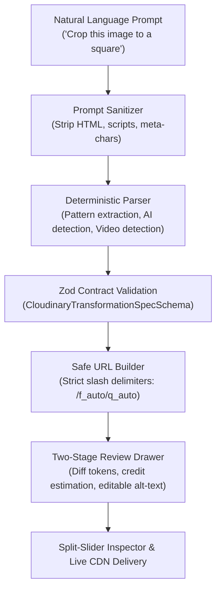

# Natural-Language Cloudinary Transformation Engine

## 1. Engine Overview

ConceptLens features a **Natural-Language Cloudinary Transformation Engine** designed to let students and educators adapt visual learning materials using conversational instructions (e.g. *"Crop to a square"*, *"Make a low-data version for 2G mobile"*, *"Resize for a lesson card"*, *"Sharpen diagram labels"*, *"Apply AI auto enhance"*).

The engine operates on a zero-trust model: every natural language instruction passes through prompt sanitization, is translated by a deterministic parser into a strictly validated Zod specification, and produces clean, standards-compliant Cloudinary delivery URLs.



---

## 2. Shared Specification Schema (`@conceptlens/shared`)

Every transformation is governed by `CloudinaryTransformationSpecSchema`:

```typescript
export const CloudinaryTransformationSpecSchema = z.object({
  assetId: z.string().min(1).max(240).refine(isValidPublicId),
  prompt: z.string().min(1).max(500),
  resourceType: ResourceTypeEnum.optional().default('image'), // 'image' | 'video'
  width: z.number().int().min(16).max(4000).optional(),
  height: z.number().int().min(16).max(4000).optional(),
  aspectRatio: z.string().optional(),
  crop: CropModeEnum.optional().default('limit'), // scale, fill, fit, limit, pad, thumb, auto, crop
  gravity: GravityEnum.optional(), // auto, auto:subject, face, center, north, south, east, west
  quality: QualitySpecSchema.optional().default('auto'), // auto, auto:best, auto:good, auto:eco, auto:low, or 1-100
  format: FormatEnum.optional().default('auto'), // auto, png, jpg, webp, avif, auto:video, mp4, auto:animated
  deliveryProfile: DeliveryProfileEnum.optional().default('default'),
  effects: z.array(z.string().regex(/^[a-z0-9_:; -]+$/i)).optional().default([]),
  aiAction: AIActionEnum.optional().default('none'), // none, auto_enhance, background_removal, gen_fill, gen_remove, gen_replace, gen_restore, upscale
  aiPrompt: z.string().max(200).optional(),
  duration: z.number().min(0.5).max(600).optional(),
  startOffset: z.number().min(0).max(600).optional(),
  isLoop: z.boolean().optional(),
  audio: z.boolean().optional().default(true),
  isScientificDiagram: z.boolean().optional().default(false),
  creditCostEstimate: z.number().int().min(1).max(300).optional().default(1),
  altText: z.string().max(280).optional(),
  explanation: z.string().max(400).optional()
});
```

---

## 3. Supported Educational Profiles & Syntax Mapping

All generated URLs strictly use **separate slash-delimited segments** for `f_auto` and `q_auto` per official Cloudinary specification.

| Natural Language Intent | Profile / Action | Generated Transformation Segments | Credit Cost | Estimated Bandwidth Reduction |
| :--- | :--- | :--- | :--- | :--- |
| **"Crop to a square"** / **"1:1 avatar"** | `square_thumbnail` | `c_fill,ar_1:1,g_auto:subject,w_400,h_400/f_auto/q_auto` | 1 tx | ~65% (est.) |
| **"Square focus on face"** | `square_thumbnail` | `c_fill,ar_1:1,g_face,w_400,h_400/f_auto/q_auto` | 1 tx | ~65% (est.) |
| **"Make low-data version"** / **"Save bandwidth"** | `low_data` | `c_limit,w_480/f_auto/q_auto:eco` | 1 tx | **~72% (est.)** |
| **"Resize for lesson card"** / **"16:9 banner"** | `lesson_card` | `c_fill,ar_16:9,g_auto,w_640,h_360/f_auto/q_auto` | 1 tx | ~55% (est.) |
| **"Sharpen diagram and labels"** | `diagram_hq` | `c_limit,w_1200/e_sharpen:80/e_contrast/f_auto/q_auto:good` | 1 tx | ~30% (High fidelity) |
| **"AI auto enhance"** | `auto_enhance` | `c_limit,w_900/e_auto_enhance/f_auto/q_auto` | 100 tx | Adaptive tone/color |
| **"Remove background"** | `background_removal` | `c_limit,w_900/e_background_removal/f_auto/q_auto` | 75 tx | Transparent specimen |
| **"Generative fill to 16:9"** | `gen_fill` | `c_pad,ar_16:9,b_gen_fill,w_800/f_auto/q_auto` | 50 tx | Expanded background |
| **"Video 5-second preview"** | `video_clip` | `so_0,du_5/c_limit,h_720/vc_auto/f_auto:video/q_auto` | 2 tx | Trimmed preview stream |
| **"Animated WebP from video"** | `animated_preview` | `du_5/e_loop/f_auto:animated/q_auto` | 2 tx | ~74 KB lightweight loop |

---

## 4. Diagram Label Readability Preservation

Scanned textbook diagrams have unique visual requirements:
1. **Never aggressive downsampling**: If labels become unreadable, learning fails. `diagram_hq` uses `c_limit,w_1200` to prevent pixelation.
2. **Ink edge sharpening (`e_sharpen:80`)**: Accentuates faded printer ink, pencil annotations, and thin cell membrane borders.
3. **Contrast flattening (`e_contrast`)**: Neutralizes book gutter shadows, scanner curvature gradients, and page yellowing.
4. **Smart aspect-ratio preservation**: Diagrams default to `c_limit` or `c_fit` to prevent cropping out essential axis titles or organelle legends.

---

## 5. Educational Safeguard for Scientific Diagrams

Generative AI transformations (`b_gen_fill`, `e_gen_remove`, `e_gen_replace`) present educational risks when applied to canonical scientific diagrams:
- Hallucinating additional organelles in biological cells.
- Distorting the anatomical connections of cardiac valves or chambers.
- Altering complementary nucleotide base pairings (A-T, G-C) in DNA models.

To preserve scientific fidelity:
1. Canonical specimens are flagged with `isScientificDiagram: true`.
2. When a generative prompt is submitted, the engine sets `isEducationalSafeguarded: true` and returns a `previewNotice`.
3. In the UI, an **Educational Safeguard Warning** is rendered requiring explicit learner acknowledgment before applying the modification.

---

## 6. Two-Stage Preview vs. Applied Workflow

Modifications do not blindly mutate the learner's active diagram. Instead:
1. **Stage 1 (Preview Mode)**:
   - Displays proposed parameter diff (e.g. `c_fill,ar_1:1`, `e_sharpen:80`, `/f_auto/q_auto`).
   - Displays estimated Cloudinary credit cost (`tx`) and estimated bandwidth savings.
   - Provides an editable **Accessible Alt-Text** field allowing educators and learners to describe visual changes for screen readers.
2. **Stage 2 (Inspection & Commitment)**:
   - The user can inspect the change via the interactive comparison split slider (with arrow key keyboard navigation) or side-by-side mode.
   - **Apply Transformation**: Commits the preview as the active diagram.
   - **Discard / Return**: Cancels the preview and restores the previous baseline.

---

## 7. Security & Sanitization Rules

1. **Path Traversal Protection**:
   `isValidPublicId(id)` rejects any string containing `..`, `://`, or leading `/`.
2. **Prompt Injection & XSS Stripping**:
   `sanitizePrompt()` strips `<script>`, `<style>`, inline execution tokens (`alert()`, `eval()`), and shell characters (`;`, `&`, `$`, `` ` ``).
3. **Zod Bounds Verification**:
   Dimensions must be between 16px and 4000px. Quality values are clamped and validated against permitted Cloudinary presets.
4. **Credential Isolation**:
   URL builders never accept or concatenate `CLOUDINARY_API_SECRET`.

---

## 8. End-to-End API Usage

### Endpoint: `POST /api/uploads/transform-spec`

**Request Payload:**
```json
{
  "prompt": "Crop this image to a square for a specimen card",
  "assetId": "sample",
  "cloudName": "demo",
  "lowDataMode": false,
  "isScientificDiagram": true,
  "allowGenerativeModification": false
}
```

**Response Payload (200 OK):**
```json
{
  "success": true,
  "data": {
    "spec": {
      "assetId": "sample",
      "prompt": "Crop this image to a square for a specimen card",
      "resourceType": "image",
      "crop": "fill",
      "gravity": "auto:subject",
      "width": 400,
      "height": 400,
      "aspectRatio": "1:1",
      "quality": "auto",
      "format": "auto",
      "deliveryProfile": "square_thumbnail",
      "effects": [],
      "aiAction": "none",
      "isScientificDiagram": true,
      "creditCostEstimate": 1,
      "altText": "Square detail thumbnail of sample",
      "explanation": "Cropped to a 1:1 square centered on the subject with fill mode and smart content-aware gravity."
    },
    "transformedUrl": "https://res.cloudinary.com/demo/image/upload/c_fill,ar_1:1,g_auto:subject,w_400,h_400/f_auto/q_auto/sample",
    "originalUrl": "https://res.cloudinary.com/demo/image/upload/sample",
    "appliedTransforms": [
      "c_fill,ar_1:1,g_auto:subject,w_400,h_400",
      "f_auto",
      "q_auto"
    ],
    "bandwidthSavingEstimatePct": 65,
    "creditCostEstimate": 1,
    "accessibleAltText": "Square detail thumbnail of sample",
    "isEducationalSafeguarded": false
  }
}
```
