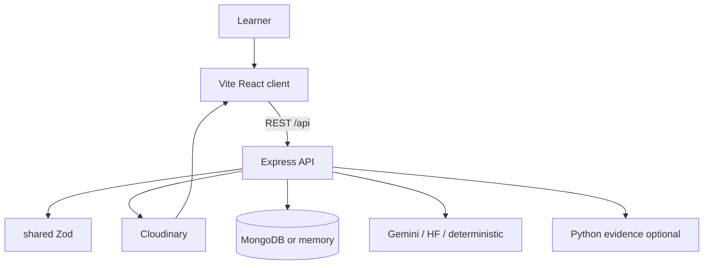

# 7. Architecture and Technology Decisions

## Monorepo layout

```
ConceptLens/
├── client/          React 18 + Vite + TypeScript
├── server/          Express + TypeScript + Cloudinary + Tesseract
├── shared/          Zod contracts (@conceptlens/shared)
├── extension/       Chrome MV3
├── python/          FastAPI + invariant / OCR helpers
├── .agents/skills/  Agent Skills Pack
├── docs/            Integration, ISL, video, this Notion kit
└── render.yaml      Single web service blueprint
```

Workspaces declared in root `package.json` (`shared`, `server`, `client`).

---

## Request flow



### API families (`server/src/index.ts`)

`/api/uploads` · `/api/diagrams` · `/api/biology` · `/api/practice` · `/api/materials` · `/api/ai` · `/api/pyqs` · `/api/lessons` · `/api/health`

---

## Decision log

| Decision | Context | Choice | Outcome |
| :--- | :--- | :--- | :--- |
| Framework | Need SPA + API secrets | Vite React + Express, not Next | One Render service serves API + `client/dist` |
| Type safety | Prevent schema drift | Shared Zod package (T3 principle, not create-t3-app) | Client/server agree at runtime |
| Media | Secrets + transforms | Cloudinary signed pipeline | Educational variants without shipping secret |
| 3D assets | School networks | Prefer procedural/SVG over sole reliance on large remote glTF | Instant lesson open; Three.js still a dependency |
| AI | Hallucination risk | Catalog-first; Gemini → HF → deterministic | Lessons still work offline of APIs |
| Persistence | Hackathon friction | Mongo + in-memory fallback | App starts without local Mongo |
| AuthZ for uploads | Abuse risk | Signed uploads; MIME/size gates | Fail closed |

---

## Key modules

| Concern | Server | Client |
| :--- | :--- | :--- |
| Diagram reliability | `validationService`, `stepEngine`, `interpretationService` | `InteractiveCanvas`, gates UI |
| Learning media | `learningMedia.ts` | `LearningMediaLab.tsx` |
| Lessons | `aiProviderService`, `deterministicLessonBuilder` | `LearnWorkspace`, `AILessonStudio` |
| A11y | — | `VoiceGuide`, `FocusRuler`, `LiveAnnouncer`, themes |
| OCR | `pageOcr.ts` + tesseract | Practice upload paths |

---

## Non-goals of the architecture (current)

- Multi-tenant auth identity  
- Claiming official board-paper copyright in the bank  
- Synthetic ISL avatars  
- Unsigned public upload presets as the default learner path  
