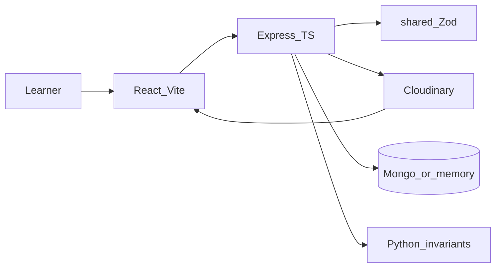

# ConceptLens — Finale Documentation for Judges

**Product:** ConceptLens · The Living Atlas  
**Tagline:** *From Your Textbook to an Experience You Can Explore.*  
**Event:** SheBuilds Hacktoberfest HackDays 2026  
**Timeline covered:** **17 October 2026 → 30 October 2026**  
**Live demo:** [https://conceptlens-58cq.onrender.com/](https://conceptlens-58cq.onrender.com/)  
**Repository:** [LovelySharma-dev/ConceptLens](https://github.com/LovelySharma-dev/ConceptLens)

| Judging weight | Criterion | Where this doc answers it |
| :---: | :--- | :--- |
| **50%** | Problem & solution execution | §§1–3, §5 A–Z features, §7 signature lesson |
| **30%** | Meaningful Cloudinary media pipeline | §6 Cloudinary skills, starter kits, transforms |
| **20%** | Documentation & build-in-public clarity | §4 day-by-day, this file, linked logs |

---

## 1. One sentence for the room

**We researched how students with different learning needs get left behind by flat textbooks, then built a browser app that teaches only what it can prove—starting with a linked list that refuses a cycle—and delivers study diagrams through a signed Cloudinary pipeline with honest fallbacks.**

Preferences are **choices, not diagnoses**. Practice items are **labeled practice**, not official past papers. This demo does **not** claim verified Indian Sign Language video on every lesson.

---

## 2. Why we started (17 Oct): special learning needs research

On **17 October 2026** we named the problem before we named the stack.

### What we researched

| Barrier | Who feels it | What textbooks / chatbots do wrong |
| :--- | :--- | :--- |
| **Spatial blindness** | Biology / anatomy learners | Flat ink cannot show volume, membranes, chambers |
| **Dynamic invisibility** | CS + physiology learners | Pointer rewiring and blood flow are **time**; a still arrow hides change |
| **Attention & pacing** | ADHD / focus-seeking learners | Dense pages, no focus ruler, no single-step mode |
| **Reading load** | Dyslexia / Easy Read needs | Long lines, low contrast, no plain-language alternate |
| **Sensory overload** | Low-stimulation needs | Motion, flash, dark-on-dark UI |
| **Deaf / hard-of-hearing exclusion** | Visual-first learners | STEM video without captions / reviewed ISL; we chose **not to fake sign language** |
| **Low vision / keyboard-only** | Blind-friendly / motor-friendly paths | Mouse-only demos; silent state changes |
| **Low bandwidth** | School / mobile networks | Multi-MB photos and remote `.gltf` files fail |
| **AI hallucination risk** | Every exam student | Unchecked “vision AI” invents structures students memorize |

### Design principles that came from that research

1. **Reliability before expansion** — fail closed (cycle → stop) instead of animating a lie.  
2. **Confirm before explain** — learner reviews extracted text; we do not silently invent OCR.  
3. **Catalog-first, model-second** — curated lessons and Zod contracts before optional Gemini.  
4. **Choice, not diagnosis** — ADHD-friendly / dyslexia-friendly / deaf-friendly are **modes**, never clinical labels stored about a person.  
5. **Honest media** — if Cloudinary is misconfigured, show an error; never substitute a public demo image and claim it is the project account.  
6. **Zero synthetic ISL** — schema + player + fallback to ISLRTC links; empty verified catalog rather than avatar hallucination.

Aligned aims (not endorsement): [UN SDG 4](https://sdgs.un.org/goals/goal4) Quality Education and [SDG 10](https://sdgs.un.org/goals/goal10) Reduced Inequalities.

---

## 3. What we shipped (product shape)

```
Home (signature linked-list proof + mission)
  ├─ Learn          → curated biology + NL lessons + 7 representations
  ├─ Practice       → paste / PDF text / camera / speech → confirm → rule-based explain
  ├─ ADHD Space     → focus timer + study plan (choice-based)
  ├─ Cloudinary     → Media Studio + Learning Media Lab (Explore / Focus / Low data)
  ├─ STEM Labs      → optics, pendulum, universal diagrams, reliability gates
  ├─ About          → pillars, tech disclosure, SDG narrative
  └─ Extension      → Chrome MV3 “ConceptLens Everywhere” (dyslexia fonts, focus ruler)
```

**Stack (MERN + T3 patterns, not create-t3-app):** React 18 + Vite · Express + TypeScript · MongoDB/Mongoose (in-memory fallback) · Zod shared contracts · Cloudinary · optional Gemini · Python invariant suite.

---

## 4. Timeline A → Z (17 Oct → 30 Oct)

| Day | Date | What we did | Why |
| :---: | :--- | :--- | :--- |
| **A** | **17 Oct** | Idea & planning: ConceptLens named; PRD + phases; scope cut from “AI reads any page” to curated + deterministic list | A judge-demo must be **checkable**, not open-ended |
| **B** | **18 Oct** | Research: learner barriers, Cloudinary signed-upload pattern, stack pick; decided no fake ISL / no formal WCAG claim | Honesty is part of accessibility |
| **C** | **19 Oct** | Monorepo `client` / `server` / `shared`; Zod schemas; fixtures including a **malformed cycle** | One contract package stops client/server drift |
| **D** | **20 Oct** | Concept engine: insert/delete/reverse/search; Floyd cycle gate; OCR confidence &lt; 0.80 → human review; Python invariants | Broken graphs must not look like lessons |
| **E** | **21 Oct** | Cloudinary: signature route, transform URL builder, comparison slider, status badge | Secrets stay server-side; failed account must look failed |
| **F** | **22 Oct** | Practice sandbox, lessons, PYQ routes, GitHub Actions CI (Kavita Kumari feature commit) | Immediate explanation &gt; score vanity |
| **G** | **23 Oct** | Physics lab; universal diagrams; biology studios (procedural 3D + 2D SVG fallbacks) | Remote `.gltf` fails on school networks |
| **H** | **24 Oct** | Merge `feat`→`main`; fix Python fixtures to match gates; CI green | Tests that stop checking invariants are not green |
| **I** | **25 Oct** | Learning preferences; Cloudinary React delivery; OCR + equation/chem solvers; Render deploy; **337/337** tests; 72s demo runner | Submission day evidence |
| **J** | **26–28 Oct** | Post-deadline hardening of product surface (Learn/Practice continuity, docs polish) | Keep the living atlas usable beyond the form |
| **K** | **29 Oct** | Milestone 10: contrast design tokens; website-wide **Voice Guide**; ISL schema/player foundation + honest empty catalog; new a11y tests | Inclusive modes need speech + contrast that do not lie |
| **L** | **30 Oct** | Focus-mode scroll fix; signature lesson keyboard scoping; local Learning Media Lab (Explore/Focus/Low data) verified; Render note: Cloudinary route not configured live | Judges get a truthful local vs live matrix |

Git commits concentrate on **24–25 Oct**; days **17–23** are the working calendar for the same body of work ([`HACKDAYS_NOTION.md`](./HACKDAYS_NOTION.md)).

---

## 5. Feature inventory A–Z (what · why · who it helps)

Each row: **What we built** → **Why** → **Learner need**.

| # | Feature | What | Why | Helps |
| :---: | :--- | :--- | :--- | :--- |
| **A** | **Accessibility themes (18 combinable)** | Focus, Easy Read, Simple Steps, Dyslexia typography, Low-Stimulation, Color-Blind markers, Low-Vision, Speech-Free, Keyboard/Motor-Friendly, Deaf-Friendly, Low-Data, etc. | One layout cannot serve every brain; modes are local choices | ADHD, dyslexia, low vision, motor, color-blind, low data |
| **B** | **ADHD Learning Dashboard** | Focus timer (`ready` / `running` / `paused` / `completed`) + deterministic study plan | Sustained attention needs visible state, not dark-on-dark digits | ADHD / focus |
| **C** | **About + SDG narrative** | Mission, pillars, tech disclosure | Judges and teachers need transparent limits | Everyone |
| **D** | **Biology Living Atlas** | Animal cell, heart, DNA, neuron, plant cell — interactive 2D SVG (and documented 3D path); organelle select; practice | Spatial concepts need explore, not memorize a printout | Visual STEM |
| **E** | **Camera capture (Practice)** | WebRTC snapshot + `track.stop()` on close | Bring board work in without installing apps | General / dyslexia (own notes) |
| **F** | **Chrome extension (MV3)** | Shadow DOM toolbar: dyslexia fonts, focus ruler, backend assist | Learning does not stop at our domain | Dyslexia, ADHD |
| **G** | **Cloudinary Media Studio** | Signed upload path, transform API, before/after slider (mouse/touch/arrows) | Textbook photos are noisy and heavy; CDN transforms are the educational media story (30% rubric) | Low data, low vision clarity |
| **H** | **Confirm-before-explain** | Paste / PDF text layer / sample → review → explain | OCR and parsers err; students must own the text | Trust / dyslexia correction |
| **I** | **Deterministic solvers** | Linear eq (`2x+3=11`→`x=4`), PEMDAS, chemical balance | Rule-based steps beat hallucinated arithmetic | General STEM |
| **J** | **Floyd cycle gate + Pointer Lie lesson** | 4-node reverse; break cycle → **Stopped / CYCLE** → repair → continue | *We will not teach a structure we cannot prove* | CS exams (ISC Q11-style) |
| **K** | **Keyboard shell** | `[0]`–`[6]`, `[G]`, `[H]`, `[T]`, `[?]`, lesson Space/arrows/`R` when focused | Mouse-optional classroom / motor access | Keyboard / motor |
| **L** | **Learn workspace + 7 representations** | Standard, Easy Read, Simple Steps, Spatial, Flashcards, Quiz, Notes — place preserved | Same concept, different cognitive load | Dyslexia, ADHD, exam prep |
| **M** | **Learning Media Lab** | One plant-cell asset → Original / Explore / Focus / Low-data URLs | Show Cloudinary **meaningfully**: crop ROI, bandwidth tiers | Low data, visual focus |
| **N** | **LiveAnnouncer + landmarks** | `aria-live="polite"` state announcements | Silent UIs exclude screen-reader users | Blind / low vision |
| **O** | **OCR path (gated)** | Local Tesseract when ready; confidence &lt; 0.80 → review; signature lesson does **not** OCR a photo into a list | Prevent invented text becoming “truth” | Reliability |
| **P** | **Physics STEM lab** | Thin lens `1/f=1/v−1/u`, pendulum energy | Dynamic invisibility in physics | General |
| **Q** | **PYQ intelligence (curated bank)** | ISC/CBSE/Anna/GATE-**style** drawer → launch engine | Exam relevance without claiming official papers | Exam prep |
| **R** | **Reliability gates UI (8-stage)** | Upload → media → OCR → interpret → validate → human fix → render → verify | AI without invariants is a liability | CS / educators |
| **S** | **Speech / Voice Guide** | `[G]` tours, read-aloud, visible text fallback if TTS missing | Listen & explore without trapping users | Blind, ADHD listen mode |
| **T** | **Type-safe shared Zod contracts** | `@conceptlens/shared` schemas for diagrams, ISL, Cloudinary transforms, lessons | Runtime + compile-time agreement | Engineering quality |
| **U** | **Universal diagram canvas** | Cross-domain interactive diagrams | One visualizer language across subjects | General |
| **V** | **Validation + step engine** | Deterministic `ExecutionStep[]`; StateInspector `prev`/`curr`/`next` | Mental pointer tracking fails on paper | CS |
| **W** | **WebVTT / ISL foundation** | Zod `ISLLessonResourceSchema`, player shortcuts, **empty** verified catalog + ISLRTC fallback | Ethics: no synthetic signing | Deaf / HoH (foundation) |
| **X** | **eXtension of CI & tests** | Server suites + pytest graph/OCR blur + extension tests | Evidence for reliability claims | Judges / maintainers |
| **Y** | **Yield / Low-data mode** | Defer heavy media; Cloudinary `q_auto:low` / narrow width | Rural and mobile school networks | Low bandwidth |
| **Z** | **Zero-secret client bundle** | `CLOUDINARY_API_SECRET` only on Express; status honesty | Security + demo integrity | Everyone |

---

## 6. Cloudinary — skills, starter kits, what we did and why

### 6.1 Why Cloudinary (maps to 30% judging)

School photos of diagrams are **large, glare-heavy, and format-chaotic**. Cloudinary lets us:

1. **Sign uploads on the server** so the API secret never enters the React bundle.  
2. **Transform on delivery** (`f_auto`, `q_auto`, sharpen, contrast, crop, width caps) without re-uploading.  
3. **Show educational difference** with a before/after slider and Explore / Focus / Low-data variants of one plant-cell illustration.  
4. **Fail honestly** when the account is unreachable (no fake “upload succeeded”).

### 6.2 Agent skills we installed and how we used them

| Skill (`.agents/skills/`) | What it teaches | How ConceptLens used it |
| :--- | :--- | :--- |
| **`cloudinary-media-pipeline`** | Signed upload, preserve original, MIME/size gates, crop/sharpen/responsive URLs for study diagrams & PYQs | Implemented `POST /api/uploads/signature`, `/direct`, `/transform`, `/learning-media`, `learningMedia.ts` plant-cell variants |
| **`cloudinary-react`** | Vite-default React SDK: `AdvancedImage`, `@cloudinary/url-gen`, signed-upload patterns, TS pitfalls | Client delivery helpers + Media Studio patterns; **same packages** as the official React starter |
| **`cloudinary-transformations`** | NL → URL syntax, video/AI transforms, debugging, cost awareness | `cloudinaryTransformationService.ts` + Zod `cloudinaryTransformation` schema + NL transform route |
| **`cloudinary-docs`** | Lookup via Cloudinary `llms.txt` | Kept transforms and SDK calls aligned with current docs |
| **`cloudinary-next`** | Next.js / `next-cloudinary` App Router patterns | **Reference only** — we did **not** adopt Next; Express + Vite already owned the API |

**Companion product skills (not Cloudinary, but same build):**

| Skill | Role |
| :--- | :--- |
| `mern-t3-architecture` | Monorepo layout, Zod-once contracts, Express validation gates |
| `concept-engine-validation` | 8-stage pipeline, Floyd, HITL correction |
| `inclusive-learning-isl` | Keyboard, live regions, ISL ethics, contrast |
| `pyq-intelligence` | Exam metadata schema without over-claiming sources |

### 6.3 React / Cloudinary starter kits — what we chose and why

| Kit / pattern | Did we use it? | Why / why not |
| :--- | :---: | :--- |
| **[`create-cloudinary-react`](https://github.com/cloudinary-devs/create-cloudinary-react)** (Vite + React + `@cloudinary/react`) | **Packages: yes · Scaffold CLI: no** | The kit scaffolds a **separate** React app and often puts **cloud name in client `.env`**. We already had a MERN monorepo. We took the **same SDKs and signed-upload rules**, but kept delivery of the Media Lab behind the **Express proxy** so the project cloud name is not required in the browser bundle for that path. |
| **Unsigned upload preset (starter default)** | **No as default** | Fine for throwaway demos; unsafe for student diagram uploads anyone could spam. |
| **Signed browser upload** | **Yes (implemented)** | Backend HMAC signature; client never sees `CLOUDINARY_API_SECRET`. |
| **`next-cloudinary` / Next App Router** | **No** | Would force a second framework; Express already serves API + `client/dist` on Render. |
| **create-t3-app / Next + tRPC** | **Patterns only** | We wanted Zod shared types + type-safe routes without Next. REST Express + `@conceptlens/shared` = “T3 spirit”. |
| **Create React App** | **No** | Vite is faster and matches Cloudinary’s React skill default. |
| **Remote `.gltf` anatomy kits** | **No** | Brittle on school networks; procedural / SVG lessons load instantly. |

### 6.4 Transformations we actually teach judges

| Tag / recipe | Educational why |
| :--- | :--- |
| `f_auto` / `q_auto` | Format & quality negotiation → less mobile waste |
| `e_sharpen:80` / `e_contrast` | Recover faint print / glare on classroom photos |
| `c_limit,w_900` / `w_960` / `w_320` | Cap megapixel phone dumps; Low-data tier |
| Focus crop (chloroplast ROI) | Teach “look here” without a second upload |
| Status + Local Demo Mode | Integrity: blocked account ≠ fake success |

**Local (verified for Media Lab):** project plant-cell → Explore / Focus / Low data (PNG responses recorded).  
**Live Render (30 Oct check):** Cloudinary learning-media route / credentials **not** configured — do not claim live CDN variants on the public URL until env is set.

---

## 7. Signature finale demo (~90 seconds)

*API must be running. Prefer local runner for Cloudinary Media Lab.*

1. **Problem** — Static arrows cannot show a pointer changing. Heading: *We will not teach a structure we cannot prove.*  
2. **Valid reversal** — Watch the reversal; inspector shows `prev` / `curr` / `next` from the **server**.  
3. **Break** — List cycles back; structure is invalid.  
4. **Stop** — Status **Stopped**, edge **CYCLE**, playback will not start.  
5. **Repair** — Clear the closing edge; check passes; reversal may play.  
6. **Pictures (local)** — Explore → Focus → Low data for one plant-cell illustration. Pixels are **not** parsed into the list.

Longer scripts: README §17 / [`docs/video-demo.html`](./docs/video-demo.html).

---

## 8. Evidence & honesty matrix

### Measured

- Hack Days submission window: full suite recorded **337 / 337** server tests + **6** pytest invariants (25 Oct 2026).  
- Production build clean; client bundle checked free of `CLOUDINARY_API_SECRET`.  
- Live app on Render: health + SPA + API.

### Implemented with stated limits

| Claim | Status |
| :--- | :--- |
| Linked-list proof + Floyd refuse | **Finale demo — yes** |
| Cloudinary signed pipeline code | **Yes** |
| Project-account Explore/Focus/Low-data | **Local yes · Render Oct 30 no credentials/route** |
| 18 learning preference themes | **Yes** (no formal WCAG audit) |
| Voice Guide | **Yes** (browser TTS; text fallback) |
| ISL video in catalog | **Foundation only — catalog empty by design** |
| Official board papers | **No — practice labeled practice** |
| Diagnosing ADHD/dyslexia | **Never** |

### Intentional non-claims

- No synthetic ISL avatars.  
- No “AI read this photo into a linked list” as the signature story.  
- No UN endorsement (SDG aims only).

---

## 9. Architecture (one glance)



**API families:** `/api/uploads` · `/api/diagrams` · `/api/biology` · `/api/practice` · `/api/materials` · `/api/ai` · `/api/pyqs` · `/api/lessons` · `/api/health`

---

## 10. Team & links

| Role | Person |
| :--- | :--- |
| Lead · architecture · Cloudinary · biology · docs | Lovely ([LovelySharma-dev](https://github.com/LovelySharma-dev)) |
| Practice · uploads · lessons · CI (24 Oct) | Kavita Kumari |

| Document | Path |
| :--- | :--- |
| This finale | [`finale.md`](./finale.md) |
| Notion workspace import kit (17–30 Oct) | [`docs/notion/README.md`](./docs/notion/README.md) |
| Hack Days day log | [`HACKDAYS_NOTION.md`](./HACKDAYS_NOTION.md) |
| Pitch / Notion kit (earlier) | [`NOTION_DOCUMENTATION.md`](./NOTION_DOCUMENTATION.md) |
| PRD | [`PRD.md`](./PRD.md) |
| README | [`README.md`](./README.md) |
| Cloudinary deep dive | [`docs/cloudinary-integration.md`](./docs/cloudinary-integration.md) |
| ISL ethics | [`docs/ISL_EVALUATION_AND_INTEGRATION.md`](./docs/ISL_EVALUATION_AND_INTEGRATION.md) |
| 72s showcase | [`docs/video-demo.html`](./docs/video-demo.html) |

---

## 11. Closing line for judges

From **17 October research into how “special” and everyday learning needs collide with flat STEM pages**, through a nine-day Hack Days build and post-deadline inclusive polish through **30 October**, ConceptLens is the Living Atlas that **adapts presentation without inventing science**—proven on a linked list that stops for a cycle, and delivered through a Cloudinary pipeline we wired with official React/media skills **without** pretending a starter-kit scaffold or a missing live credential was something it is not.

**Learn anything. Your way.** · **One concept. Different ways to understand it.**
